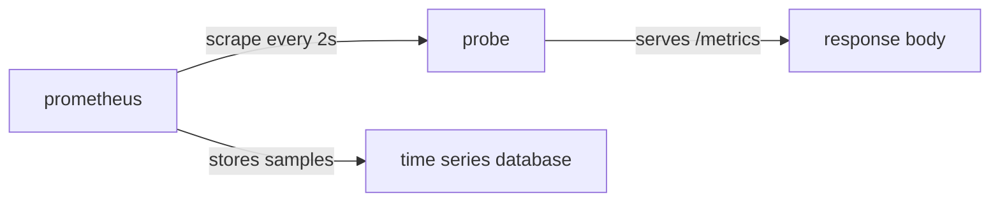
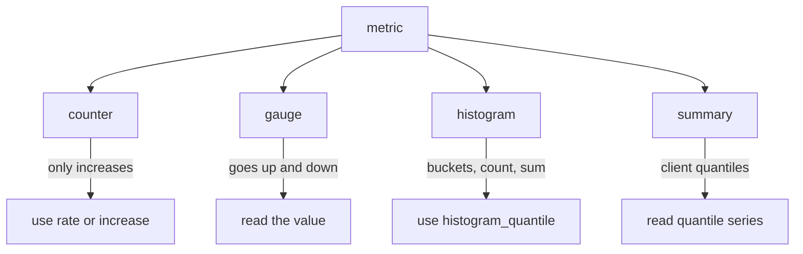

# Metric Types And The Exposition Format

Before you can choose a function to query a metric, you must know what the number means. A request count and a queue length are both numbers, but they behave in opposite ways over time. Prometheus therefore asks every application to declare a type for each metric it exposes. This part shows where that declaration lives, how Prometheus reads it and what the four types are.

## An Application Exposes Its Own Numbers

An instrumented application keeps its measurements in memory and serves them on an HTTP (Hypertext Transfer Protocol) endpoint, normally the path `/metrics`. The response body is plain text. Prometheus does not run inside the application. It sends a request to that path on a schedule and stores what comes back.

In the playground, the `probe` Deployment in the `starfleet` namespace is the instrumented application. The `shuttle` pod is a plain Python container that the exercises use to send requests inside the cluster. Prometheus runs as a separate Deployment and scrapes the `probe` Service every two seconds. A scrape is one request to the metrics path, followed by parsing the response and storing every sample with the time of the scrape.



The diagram shows that the application only exposes text and that the Prometheus server does the collecting and the storing.

## Read The Raw Text First

Start with the real response. The first step selects the playground cluster and defines a helper that fetches the metrics from inside the cluster. The helper runs Python in the `shuttle` pod because the `probe` Service name resolves only inside the cluster.

<!-- astrona:playground:renew -->

```sh
export KUBECONFIG="$(astrona kubeconfig ats-047-playground-010-01)"
test "$(kubectl config current-context)" = "kind-astro-ats-047-playground-010-01" || exit 1
```

```sh
probe_metrics() {
  kubectl -n starfleet exec shuttle -- python -c 'import urllib.request; print(urllib.request.urlopen("http://probe:8080/metrics", timeout=8).read().decode())'
}
probe_metrics
```

The output is a list of lines. Lines that start with `# HELP` hold a one-sentence description. Lines that start with `# TYPE` hold the metric name and its type. All other lines are samples. The fixture writes the lines `# TYPE lab_requests_total counter`, `# TYPE lab_queue_depth gauge`, `# TYPE lab_last_success_timestamp_seconds gauge` and `# TYPE lab_request_duration_seconds histogram`. Run the helper again and read these four lines in your own output.

## Anatomy Of A Sample Line

A sample line has three parts: the metric name, an optional set of labels in braces and a value. Labels are key and value pairs that split one metric into several series. This fixture line shows all three parts:

```text
lab_requests_total{service="probe",status="500"} 12
```

The name is `lab_requests_total`. The labels are `service` and `status`. The value is the number 12, which is only an example value here and not your output. Each distinct combination of name and label values is one time series. Prometheus stores a list of timestamped values for every series. When the scrape also supplies no timestamp, Prometheus uses the time the scrape finished.

Prometheus also adds labels of its own to every scraped series. The `job` label names the scrape configuration and the `instance` label names the target address. In the playground the job is `probe` and the instance is `probe:8080`, from the scrape configuration. These labels let you tell apart two applications that expose the same metric name.

## The Four Metric Types

The type tells Prometheus users how to read the value. The type is a convention that the client library and the person writing queries both follow. The Prometheus server itself keeps every sample as a plain floating point number and does not enforce the type when you query.

A counter is a single number that only goes up, or resets to zero when the process restarts. It counts events or amounts, such as completed requests or bytes sent. A gauge is a single number that can go up and down. It reports a current state, such as queue depth or memory in use.

A histogram records observations such as request durations into buckets. A bucket counts how many observations were less than or equal to an upper bound. The histogram also exposes a total count and a total sum of all observed values. A summary also tracks a count and a sum, and it can add quantiles that the client calculates inside the application.



The diagram connects each type to the way you normally read it.

## Names Carry Meaning Too

The Prometheus naming convention puts the unit and the kind into the name. A counter name ends in `_total`, as in `lab_requests_total`. A metric that measures time uses the base unit seconds, as in `lab_request_duration_seconds`. A metric that measures size uses bytes. A timestamp metric is a gauge whose value is seconds since the Unix epoch, as in `lab_last_success_timestamp_seconds`.

A histogram named `lab_request_duration_seconds` exposes three groups of series. The `_bucket` series carry an `le` label for the upper bound. The `_sum` series carry the sum of observed values. The `_count` series carry the number of observations. The `_count` equals the bucket whose bound is `+Inf`.

## Query The Same Data From Prometheus

The raw text is what the application exposes. Prometheus stores that text as series that you can query with PromQL (Prometheus Query Language), the language for selecting and calculating on series. The HTTP API path `/api/v1/query` evaluates an expression at one moment. The helper below sends an expression to it from the `shuttle` pod.

```sh
prom_query() {
  kubectl -n starfleet exec shuttle -- python -c 'import sys,urllib.parse,urllib.request; print(urllib.request.urlopen("http://prometheus:9090/api/v1/query?"+urllib.parse.urlencode({"query":sys.argv[1]}),timeout=8).read().decode())' "$1"
}
prom_query 'lab_requests_total'
prom_query 'up'
```

The first query returns one series for each combination of the `service` and `status` labels. The second query selects the built-in `up` metric. Prometheus writes `up` with the value 1 after each successful scrape and 0 after a failed one, one series per target. The `up` series for the `probe` job tells you whether the scrape itself works before you trust any other value.

## What You Know Now

You know that an application exposes text, that Prometheus scrapes and stores it, and that a `# TYPE` line declares one of four types. You can read a sample line as a name, labels and a value, and you know that the unit and the kind appear in the name. The open question is how to read a counter, because its raw value is a running total that grows forever.

## Common pitfalls

> [!WARNING]
> The type is a declaration by the application, not a rule enforced by the Prometheus server. If an application exposes a falling number as a counter, the server stores it without complaint and `rate()` then reports wrong results. Check the `# TYPE` line before you pick a function. Also remember that a name ending in `_total` does not make a metric a counter if its `# TYPE` line says otherwise.
