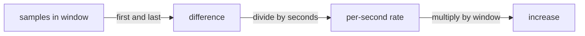

# Counters, Resets And Rate

A counter answers the question "how many times has this happened since the process started". That total is rarely what an operator needs. An operator needs to know how fast events happen now, or how many happened in the last five minutes. This part explains how PromQL (Prometheus Query Language) turns a running total into a rate, and what happens to that calculation when the total drops back to zero.

## A Raw Counter Is A Running Total

A counter value starts at zero when the process starts and only increases while the process runs. The `lab_requests_total` counter in the playground counts completed requests, one series for status `200` and one for status `500`. A process that has run for a week holds a large number even if it receives almost no requests today. A process that restarted a minute ago holds a small number even if it is busy.

For that reason, you never compare services by raw counter values, and you never alert on a raw counter. You look at how the value changes between samples. The two functions that do this are `rate()` and `increase()`.

## The rate And increase Functions

The first function, `rate()`, takes a range vector and returns the average per-second increase over that range. A range vector is a selector followed by a time window in square brackets, such as `lab_requests_total[1m]`. It selects all samples of each series that fall inside the last minute. The second function, `increase()`, returns the total increase over the same window. Mathematically, `increase(x[1m])` equals `rate(x[1m])` multiplied by 60.

Run both in the playground. Select the cluster first and define the query helper that sends an expression to the Prometheus HTTP API from the `shuttle` pod.

<!-- astrona:playground:renew -->

```sh
export KUBECONFIG="$(astrona kubeconfig ats-047-playground-010-01)"
test "$(kubectl config current-context)" = "kind-astro-ats-047-playground-010-01" || exit 1
```

```sh
prom_query() {
  kubectl -n starfleet exec shuttle -- python -c 'import sys,urllib.parse,urllib.request; print(urllib.request.urlopen("http://prometheus:9090/api/v1/query?"+urllib.parse.urlencode({"query":sys.argv[1]}),timeout=8).read().decode())' "$1"
}
prom_query 'rate(lab_requests_total[1m])'
prom_query 'increase(lab_requests_total[1m])'
```

The traffic generator sends about four requests per second and every tenth request asks for status 500. The `rate()` result for status `500` is therefore expected to be near 0.4 and the result for status `200` near 3.6, within the accuracy of the timing. Compare the values from your own run with these expectations. If the playground has run for less than a minute, the window holds fewer samples and the values may be missing or rough.

## How rate Works Inside The Window

The function `rate()` does not take the last two samples. It takes the first and the last sample inside the window, divides the difference by the time between them and then extrapolates to the edges of the window. Because the scrape interval is two seconds, a one-minute window holds about thirty samples per series. With the default scrape interval of one minute in many real setups, a window needs at least two samples to produce a result, so the window must be several times larger than the interval. A common rule is a window of at least four scrape intervals.



The diagram shows that `increase()` is the same calculation as `rate()` with a different unit.

The function `irate()` is a variant that uses only the last two samples in the window. It reacts faster and is useful for graphs of fast-moving counters, but it hides short spikes between samples. It is not suitable for alert rules, because a brief dip or spike in the last two samples changes the result.

## Counter Resets

A counter lives in the memory of the process. When the process restarts, the counter starts from zero again. The next sample that Prometheus stores is lower than the one before it. That event is a counter reset.

The functions `rate()` and `increase()` detect a drop between two consecutive samples and treat it as a reset. They assume the counter restarted at zero and add the value before the reset to the later values. The result is a smooth rate across the restart instead of a large negative number. This detection is the reason a counter type exists. A gauge that falls has no such handling.

The detection has limits. If a counter resets and then grows past its previous value between two scrapes, Prometheus sees only an increase and cannot know a reset happened. If a process crashes, increments between the last scrape and the crash never reach Prometheus. A small error in `increase()` at a restart is normal.

## Summing And Selecting Series

A rate query returns one result for each series. To get a single total, aggregate after you apply the rate. The expression `sum(rate(lab_requests_total[1m]))` returns the total request rate over both statuses. The expression `sum by (status) (rate(lab_requests_total[1m]))` returns one result per status. To select one series, use a label matcher in braces: `rate(lab_requests_total{status="500"}[1m])`.

The aggregation operators `sum`, `avg`, `min`, `max` and `count` take an optional `by` or `without` clause that decides which labels survive. The order matters. Always apply `rate()` to each raw series first and then sum. If you sum the raw counters first and then apply `rate()`, a reset of one series makes the sum drop in a way that no longer matches a single reset, and the result becomes wrong. PromQL does not allow `rate(sum(...)[1m])` directly, which helps you avoid the mistake.

```sh
prom_query 'sum(rate(lab_requests_total[1m]))'
prom_query 'sum by (status) (rate(lab_requests_total[1m]))'
prom_query 'sum(rate(lab_requests_total{status="500"}[1m])) / sum(rate(lab_requests_total[1m]))'
```

The third expression divides the failing request rate by the total request rate. The result is the fraction of requests that fail in the last minute. In this fixture the expected value is near 0.1. Both sides of the division use the same window, so the result is a ratio of rates that cover the same period.

## A Counter Is Not A Measure Of Current Load

A raw counter also depends on how long the process has lived, which is a fact about the process and not about the traffic. A busy process can show a small total and a calm process a large one. The rate removes that bias. A rate also hides short spikes that fit inside the window. A burst of one second in a five-minute window barely moves the average. Choose the window by the question: a short window shows recent change and is noisy, and a long window is smooth and slow to react.

A series that stops being scraped does not turn into zero. After the target disappears, Prometheus marks the series stale and the expression returns no result for it. A rate of zero and a missing result are different facts: zero means the target was scraped and nothing happened, and missing means there is no data.

## Choosing The Window

The window in brackets is a choice you make in every query. A short window such as `[30s]` reacts quickly but holds few samples and varies more. A long window such as `[10m]` is smooth but reacts slowly, and it blends old and new behaviour.

Alert rules usually use a window that is a few times the scrape interval, long enough to survive one missed scrape. Graphs often use a window that matches the resolution of the chart.

## What You Know Now

You can explain why a counter is read with `rate()` or `increase()`, how reset detection works and where it fails. You know to apply the rate before a sum and to use the same window on both sides of a ratio. The open question is the other kind of number, the value that can go down because the thing it measures goes down. That is a gauge.

## Common pitfalls

> [!WARNING]
> Do not graph or alert on a raw counter value. Do not use a window smaller than about four scrape intervals, because `rate()` then has too few samples. Do not sum counters before you apply `rate()`. Do not read a missing result as zero: no result means no data, while a result of zero means the target reported no events.
