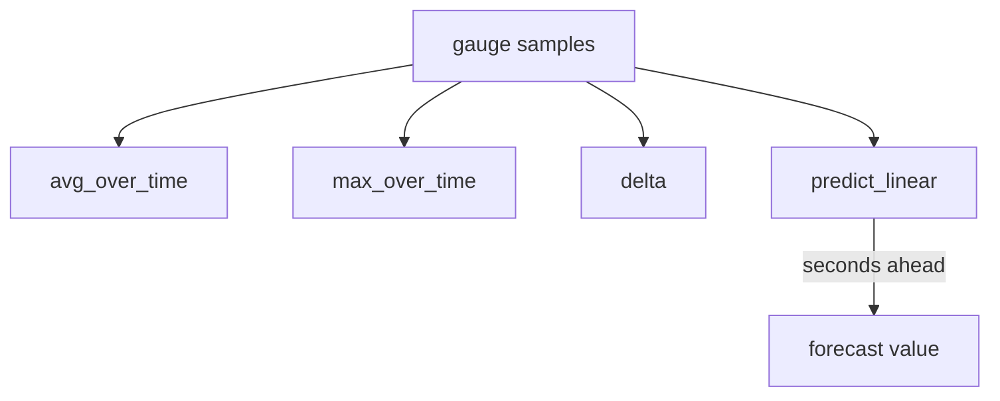

# Gauges And Current State

Not every measurement counts events. Some measurements describe how things are at this moment: how many items wait in a queue, how much memory a process uses, or when the last success happened. These values move in both directions. This part explains the gauge type, the PromQL functions that suit it and the mistakes that follow when a gauge is read like a counter.

## A Gauge Is A Value Set By The Application

A gauge holds one number that the application sets, increases or decreases. The client library offers operations such as set, add and subtract. The value in the exposition text is the value at the moment of the scrape. Nothing in the gauge records what happened between two scrapes.

The playground `probe` exposes two gauges. The gauge `lab_queue_depth` reports the number of queued items. The fixture sets it to a fixed number and never changes it. The gauge `lab_last_success_timestamp_seconds` reports the Unix time, in seconds, of the last request that completed with status 200. Unix time counts the seconds since 1 January 1970, and many applications use it to report when something last happened.

Read both gauges directly. Select the cluster and define the query helper first.

<!-- astrona:playground:renew -->

```sh
export KUBECONFIG="$(astrona kubeconfig ats-047-playground-010-01)"
test "$(kubectl config current-context)" = "kind-astro-ats-047-playground-010-01" || exit 1
```

```sh
prom_query() {
  kubectl -n starfleet exec shuttle -- python -c 'import sys,urllib.parse,urllib.request; print(urllib.request.urlopen("http://prometheus:9090/api/v1/query?"+urllib.parse.urlencode({"query":sys.argv[1]}),timeout=8).read().decode())' "$1"
}
prom_query 'lab_queue_depth'
prom_query 'lab_last_success_timestamp_seconds'
```

The first result is the number the fixture sets. The second result is a large number close to the current Unix time. Because the timestamp keeps moving forward while the application receives successful requests, its raw value is not interesting by itself. What matters is how old it is.

## Turn A Timestamp Into An Age

A timestamp gauge becomes useful when you subtract it from the current time. The PromQL function `time()` returns the evaluation time of the query as Unix seconds. The expression `time() - lab_last_success_timestamp_seconds` returns the number of seconds since the last success. An alert rule can then fire when this age exceeds a limit, for example when it is larger than 60.

```sh
prom_query 'time() - lab_last_success_timestamp_seconds'
```

In the playground, successes arrive several times per second, so the age should stay small. If a traffic generator stopped, the age would keep growing. This is the reason timestamp gauges are useful for batch jobs: a job that stops reporting produces a growing age without any event to count.

## Functions That Fit Gauges

A plain selector returns the latest sample of a gauge. To look at a gauge over time, PromQL offers functions that take a range vector. The function `avg_over_time()` averages the samples in the window. The functions `min_over_time()` and `max_over_time()` return the smallest and largest sample. The function `delta()` returns the difference between the last and the first sample in the window. The function `deriv()` estimates the per-second slope by linear regression. The function `predict_linear()` extends that slope into the future.



The diagram shows that each function reads the same samples and answers a different question about the value over time.

Run three of them against the fixture queue gauge:

```sh
prom_query 'avg_over_time(lab_queue_depth[1m])'
prom_query 'max_over_time(lab_queue_depth[1m])'
prom_query 'delta(lab_queue_depth[1m])'
```

Because the fixture never changes the queue depth, the average and the maximum are expected to equal the current value and the delta is expected to be zero. The point of running them is to see that each function takes a range vector and returns one value per series. With a real queue, `max_over_time()` is what you want when a short peak matters, since a single scrape may miss the peak.

## Why rate Is Wrong For A Gauge

The function `rate()` assumes that a decrease between samples is a counter reset. If you apply it to a gauge, every normal decrease is treated as a restart. The function then adds the value before the drop to the later values, and the result is a large positive number for a queue that was draining. The function does not warn you. The query works, the graph draws and the numbers are wrong.

The opposite mistake is just as common. If you read a counter with a plain selector, the value only grows, and a graph of it shows a line that climbs forever. A chart that always climbs is the usual sign of a counter that needs `rate()`.

A third mistake comes from a gauge that is really a counter in disguise. An application that keeps a running total and writes it with a set operation exposes a gauge that happens to increase. If the process restarts, the value falls to zero, and no function treats the fall as a reset. The type must match how the value behaves.

## Gauges And The Scrape Interval

A gauge shows its value at the instant of each scrape. A queue that fills and empties between two scrapes leaves no trace. With a scrape interval of two seconds, as in the playground, a peak that lasts half a second can be invisible. With the common interval of one minute it is likely to be invisible.

When short peaks matter, the application should track the peak itself, for example with a separate gauge for the highest value since the last scrape, or with a histogram of observations. A function such as `max_over_time()` only works with the samples that Prometheus actually stored.

## Aggregating Gauges

Gauges aggregate with the ordinary aggregation operators. The expression `sum(lab_queue_depth)` adds the queue depths of all instances and gives the total backlog. The expression `max(lab_queue_depth)` returns the deepest queue. The expression `avg(lab_queue_depth)` returns the mean. Choose the operator from the question: a total backlog uses `sum`, a worst case uses `max`.

```sh
prom_query 'sum(lab_queue_depth)'
prom_query 'max by (job) (lab_queue_depth)'
```

The `by (job)` clause keeps the `job` label and removes all other labels from the result, so you get one value per job.

## What You Know Now

You can read a gauge directly, turn a timestamp gauge into an age and use the `_over_time` functions, `delta()` and `predict_linear()` for gauges. You know that `rate()` on a gauge gives wrong numbers without an error, and that a scrape sees only the value at its own moment. The open question is what to do when you need the shape of many observations, such as request durations. That needs a distribution.

## Common pitfalls

> [!WARNING]
> Do not apply `rate()` or `increase()` to a gauge, because every drop looks like a counter reset. Do not read a short peak from a gauge scraped at a long interval. Do not use a gauge for a running total: after a restart the value falls and no function treats it as a reset.
