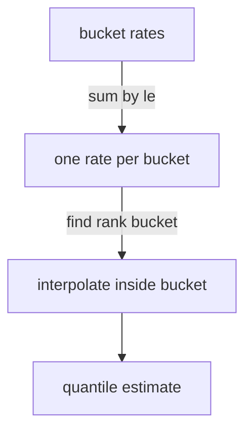

# Histograms And Summaries

An average request duration hides the slow requests that users notice. Ninety-nine fast requests and one very slow request produce a small average. To describe how durations are spread, an application needs to record the distribution of its observations. Prometheus offers two types for this: the histogram and the summary. This part explains what each one exposes, how to calculate with it and why the two are not interchangeable.

## What A Histogram Exposes

A histogram has a list of bucket upper bounds, chosen by the developer in the code. For each observation, the client library increases the count of every bucket whose bound is greater than or equal to the observed value. The buckets are cumulative: the bucket with bound 0.1 also contains everything counted in the bucket with bound 0.05. The last bucket has the bound `+Inf` and contains every observation.

The histogram also exposes `_sum`, the sum of all observed values, and `_count`, the number of observations. All of these series are counters. They only grow, and they reset on restart. For that reason you always read them with `rate()` or `increase()`.

Read the raw histogram in the playground. Select the cluster and define the helper that fetches the metrics text first.

<!-- astrona:playground:renew -->

```sh
export KUBECONFIG="$(astrona kubeconfig ats-047-playground-010-01)"
test "$(kubectl config current-context)" = "kind-astro-ats-047-playground-010-01" || exit 1
```

```sh
probe_metrics() {
  kubectl -n starfleet exec shuttle -- python -c 'import urllib.request; print(urllib.request.urlopen("http://probe:8080/metrics", timeout=8).read().decode())'
}
probe_metrics | grep lab_request_duration_seconds
```

The output has one `_bucket` line for each of the bounds 0.01, 0.05, 0.1 and `+Inf`, then one `_sum` line and one `_count` line. Check that the `+Inf` bucket equals the `_count` value, and that each bucket value is equal to or larger than the one before it.

## Reading A Fraction From Buckets

Buckets let you answer questions of the form "what fraction of requests finished within a limit". The limit must be one of the bucket bounds. To find the fraction of requests that took 0.05 seconds or less, divide the rate of the bucket with `le="0.05"` by the rate of the total count. Define the query helper and run the expression:

```sh
prom_query() {
  kubectl -n starfleet exec shuttle -- python -c 'import sys,urllib.parse,urllib.request; print(urllib.request.urlopen("http://prometheus:9090/api/v1/query?"+urllib.parse.urlencode({"query":sys.argv[1]}),timeout=8).read().decode())' "$1"
}
prom_query 'sum(rate(lab_request_duration_seconds_bucket{le="0.05"}[1m])) / sum(rate(lab_request_duration_seconds_count[1m]))'
```

The fixture waits ten milliseconds before it answers, so nearly all requests are expected to finish within 0.05 seconds and the fraction is expected to be close to 1. This type of expression is the basis of a latency indicator such as "the share of requests faster than 300 milliseconds". It is exact for the bound you choose, because it uses real counts and no estimate.

## Estimating A Quantile

A quantile is the value below which a given fraction of observations fall. The 0.95 quantile, often called p95, is the duration that 95 percent of requests stay under. PromQL estimates a quantile from buckets with `histogram_quantile()`. The first argument is the quantile between 0 and 1. The second argument is the rate of the bucket series, aggregated so that the `le` label remains.

```sh
prom_query 'histogram_quantile(0.95, sum by (le) (rate(lab_request_duration_seconds_bucket[1m])))'
```

The function finds the bucket that contains the requested rank. It then assumes that observations are spread evenly inside that bucket and interpolates. The result is an estimate, and its error depends on the width of the bucket. If all requests fall in the bucket between 0.01 and 0.05, the p95 is placed somewhere in that range whatever the real values are.



The diagram shows that the estimate comes from the bucket that holds the requested rank and that interpolation produces the final number.

Three rules follow. Choose bucket bounds near the values that matter, such as your latency objective. Keep `le` in the `by` clause, because the function needs it. Aggregate across instances before the function, with `sum by (le)`, since buckets from different instances use the same bounds and add up correctly.

## The Mean From Sum And Count

The `_sum` and `_count` series give the mean without any bucket. Divide the rate of the sum by the rate of the count:

```sh
prom_query 'sum(rate(lab_request_duration_seconds_sum[1m])) / sum(rate(lab_request_duration_seconds_count[1m]))'
```

The result is the mean duration in seconds over the last minute. The mean is not the same as a high quantile. In the earlier example of ninety-nine fast requests and one slow request, the mean stays small and the p99 shows the slow request. State which statistic answers the question before you use it in an objective or an alert.

## What A Summary Exposes

A summary also exposes `_sum` and `_count`. Instead of buckets, it exposes quantile series that the client library computes inside the application. The text format shows them with a `quantile` label, as in this format example, which is not output from the playground:

```text
# TYPE example_duration_seconds summary
example_duration_seconds{quantile="0.5"} 0.012
example_duration_seconds{quantile="0.99"} 0.31
example_duration_seconds_sum 41.7
example_duration_seconds_count 1500
```

The quantiles are exact for that one process over a sliding time window, within the accuracy of the client algorithm. The quantiles are chosen in the code, and you cannot calculate a different one later. The playground fixture exposes no summary, so this module shows the format only.

## Why Quantiles Cannot Be Averaged

Two instances each expose a p99 as a summary. You cannot average the two values to get the p99 of both instances together. A p99 describes the position inside one set of observations, and the average of two positions is not the position inside the combined set. If one instance serves ten times as many requests, its observations dominate the combined p99, and an average ignores that.

A histogram has no such problem. Bucket counts from different instances add up, and `histogram_quantile()` runs on the sum. For this reason, a histogram is the usual choice when a fleet of instances must produce one percentile. A summary suits a single process, or a case where the exact client quantile matters more than aggregation.

Prometheus also supports native histograms, a newer representation that stores buckets in a more compact form. This module uses classic histograms, which the fixture exposes with `le` labels.

## What You Know Now

You can read the bucket, sum and count series of a histogram, calculate a fraction under a limit, estimate a quantile and calculate a mean. You know that a summary exposes client quantiles that cannot be combined across instances. The open question is how labels and aggregation change these results when many instances and many label values exist.

## Common pitfalls

> [!WARNING]
> Do not call `histogram_quantile()` on raw bucket counters without `rate()`, because the total since the start hides current behaviour. Do not drop the `le` label before the function. Do not average summary quantiles across instances. Do not expect a precise quantile from wide buckets: the result is an interpolated estimate.
