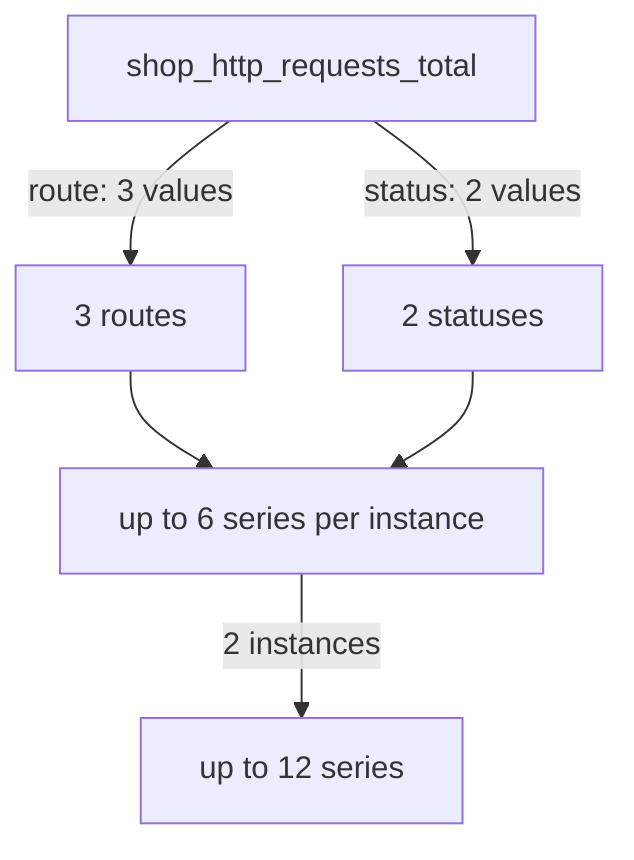

# Labels, Series And Cardinality

Labels make metrics useful, because they let one metric describe many routes, status codes or servers. Labels also make metrics expensive, because each new label value creates a new series that Prometheus must store and query. This part explains how a series is identified, what cardinality means and how one careless label can overload a monitoring system.

## A Series Is A Name Plus A Label Set

A time series is the list of timestamped values for one metric name and one exact set of label values. The two lines `shop_http_requests_total{route="/cart",status="200"}` and `shop_http_requests_total{route="/cart",status="500"}` share a name, and they belong to two different series. Changing any label value, adding a label or removing a label creates a different series.

Prometheus adds labels to every sample when it scrapes. The label `job` holds the name of the scrape job, and the label `instance` holds the address of the target. In the playground, the job is `shop` and the instances are `shop-a:8080` and `shop-b:8080`. The scrape adds these two labels, so the application does not need to set them.

Look at the real series. Select the cluster and define a helper that fetches the metrics text of one instance.

<!-- astrona:playground:renew -->

```sh
export KUBECONFIG="$(astrona kubeconfig ats-047-playground-010-02)"
test "$(kubectl config current-context)" = "kind-astro-ats-047-playground-010-02" || exit 1
```

```sh
shop_metrics() {
  kubectl -n starfleet exec shuttle -- python -c 'import sys,urllib.request; print(urllib.request.urlopen("http://%s:8080/metrics" % sys.argv[1], timeout=8).read().decode())' "$1"
}
shop_metrics shop-a | grep '^shop_http_requests_total'
```

The output has one line for each combination of `route` and `status` that the traffic generator has sent. The generator uses three routes and two statuses, so you should see up to six lines. Each line is a separate series, and each one holds its own counter.

## Cardinality Is The Number Of Series

Cardinality is the number of distinct series that a metric produces. The cardinality of a metric is the product of the numbers of values of each label, when all combinations occur. A metric with three routes and two statuses has up to six series. A metric with a label that has fifty values has fifty series.



The diagram shows that label value counts multiply and that every instance adds its own copy of the series.

Ask Prometheus to count series for each metric name in the job. Define a query helper and run the count:

```sh
prom_query() {
  kubectl -n starfleet exec shuttle -- python -c 'import sys,urllib.parse,urllib.request; print(urllib.request.urlopen("http://prometheus:9090/api/v1/query?"+urllib.parse.urlencode({"query":sys.argv[1]}),timeout=8).read().decode())' "$1"
}
prom_query 'count by (__name__) ({job="shop"})'
```

The internal label `__name__` holds the metric name, so grouping by it returns one count for each metric name. One metric should stand out with a much larger count than the others. Compare its name and its label with the other metrics.

## An Unbounded Label

The metric `shop_user_requests_total` in the fixture has a label named `user_id`, with one value for every user that sent a request. The traffic generator uses fifty user identifiers, so the metric already has fifty series on each instance. A real shop with a million users would create a million series for this one metric.

A label is unbounded when the number of its values has no fixed limit. User identifiers, request identifiers, email addresses, full URLs with query strings and timestamps are typical unbounded values. They grow with the traffic, and their growth is not under the control of the person who runs Prometheus. A label is bounded when the developer can list all possible values, such as an HTTP method, a status code or a route template.

## What Cardinality Costs

Prometheus keeps the series of the most recent time range in memory, in a structure called the head block. Each series needs memory for its labels, an index entry and the recent samples. More series mean more memory, more disk space, a larger index and slower queries, because a selector must find and load every matching series.

The cost does not depend on the traffic volume. A label value that appears once still creates a series, and the series stays for the retention period of the data. A short burst of random label values, for example a bug that puts a request identifier into a label, can add thousands of series in minutes. The Prometheus server may then run out of memory and restart.

## Where Per-User Detail Belongs

If you need to know what one user did, a metric is the wrong tool. A metric aggregates events into numbers and loses individual events. Structured logs hold one record for each request, and traces hold one record for each request path across services. Both can carry a user identifier or a request identifier, because they are stored as individual records and not as series.

A good label answers a question that you will group or filter by in a query: which route, which status class, which instance. If you would never write `by (label)` or `{label="..."}` in a query, the label should not be there.

## Controlling Cardinality

The first control is to design labels with bounded values in the code. A route label should hold the route template `/items/{id}`, and not the real path `/items/48213`. The second control is to check cardinality regularly with a query like the one above. The third control sits in the scrape configuration: a `metric_relabel_configs` rule can drop a metric or a label after the scrape and before storage. That is a last defence, because the application still computes the label and the scrape still transfers the text.

```sh
prom_query 'count({job="shop"})'
prom_query 'count by (instance) ({job="shop"})'
```

The first expression counts all series of the job. The second counts them for each instance. The two instances run the same code, but the counts can differ when the traffic has produced different label values.

## What You Know Now

You know that a series is a metric name plus an exact label set, that cardinality is the number of series and that label value counts multiply. You can find the metric that creates the most series and explain why an unbounded label costs memory and query time. The open question is how to combine many series into the numbers an operator needs.

## Common pitfalls

> [!WARNING]
> Do not put user identifiers, request identifiers or raw URLs into labels. Do not assume that low traffic means low cost, because cost follows the number of distinct label values. Do not rely on `metric_relabel_configs` as the main fix: correct the label in the application.
