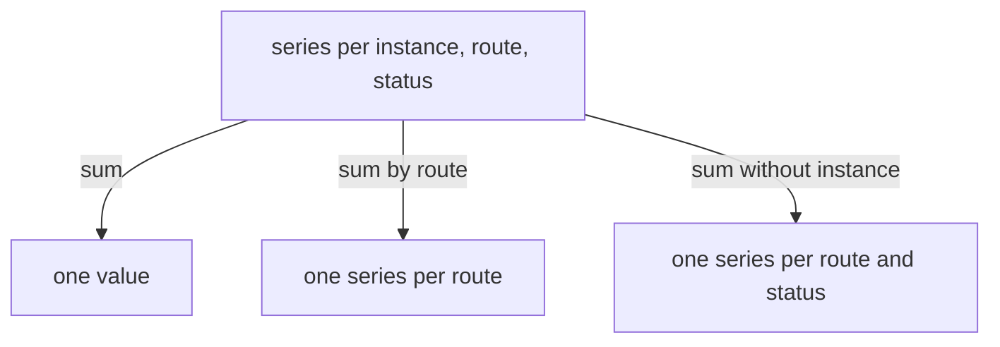

# Aggregation And Fleet Ratios

One service often runs as several instances, and each instance exposes its own series. An operator rarely asks about one instance. The question is usually about the whole service: how many requests per second, what share of them fail. This part shows how to combine series with aggregation operators and why the order and the grouping decide whether the answer is right.

## Aggregation Operators

An aggregation operator takes an instant vector, which is a set of series with one value each at one moment, and returns a smaller vector. The operators are `sum`, `avg`, `min`, `max`, `count`, `topk` and a few more. Each operator takes a `by` clause or a `without` clause. The clause `by (route)` keeps only the label `route` and removes all others. The clause `without (instance)` removes only the label `instance` and keeps the rest.

Start with the request rate of both instances. Select the cluster and define the query helper.

<!-- astrona:playground:renew -->

```sh
export KUBECONFIG="$(astrona kubeconfig ats-047-playground-010-02)"
test "$(kubectl config current-context)" = "kind-astro-ats-047-playground-010-02" || exit 1
```

```sh
prom_query() {
  kubectl -n starfleet exec shuttle -- python -c 'import sys,urllib.parse,urllib.request; print(urllib.request.urlopen("http://prometheus:9090/api/v1/query?"+urllib.parse.urlencode({"query":sys.argv[1]}),timeout=8).read().decode())' "$1"
}
prom_query 'rate(shop_http_requests_total[1m])'
prom_query 'sum(rate(shop_http_requests_total[1m]))'
prom_query 'sum by (route) (rate(shop_http_requests_total[1m]))'
```

The first query returns one series for each combination of `route`, `status` and `instance`. The second adds them all into one value, which is the request rate of the whole fleet. The third keeps the `route` label, so it returns one series per route. The label sets in the output show which labels each query keeps.



The diagram shows that the clause decides which labels remain, and so how much detail the result keeps.

## Rate First, Then Sum

The function `rate()` must see the raw counter of each series, so that it can detect counter resets in that series. After the rate is calculated for each series, the sum is safe. The expression `sum(rate(x[1m]))` is correct. PromQL does not accept `rate(sum(x)[1m])` as written, and the idea behind it would hide resets: if one instance restarts, the sum of the counters falls, and the fall is no longer a reset of any single counter.

## A Ratio Of Sums

An error ratio is the number of failed requests divided by the number of all requests. For a fleet, both numbers must cover the whole fleet. The correct expression divides the sum of the failure rates by the sum of all request rates:

```sh
prom_query 'sum(rate(shop_http_requests_total{status="500"}[1m])) / sum(rate(shop_http_requests_total[1m]))'
```

In the playground, `shop-a` receives about four requests per second and fails one in ten. The instance `shop-b` receives about one request per second and fails one in two. The fleet fails about 0.9 requests out of five in each second, which is a ratio near 0.18.

## An Average Of Ratios Is Wrong

Now calculate the ratio for each instance, and then average the two ratios:

```sh
prom_query 'sum by (instance) (rate(shop_http_requests_total{status="500"}[1m])) / sum by (instance) (rate(shop_http_requests_total[1m]))'
prom_query 'avg(sum by (instance) (rate(shop_http_requests_total{status="500"}[1m])) / sum by (instance) (rate(shop_http_requests_total[1m])))'
```

The first query returns one ratio for each instance, near 0.1 and near 0.5. The second averages them, and the result is near 0.3. That number is wrong for the fleet, because it gives the small instance the same weight as the busy one. The ratio of sums weighs each instance by its traffic, and the average of ratios does not.

Both sides of the division in the first query use `by (instance)`. When two vectors are divided, PromQL matches series that have exactly the same label set. If one side keeps a label that the other side lacks, no series match and the result is empty.

## Counting And Ranking Series

Aggregation also answers questions about the metrics themselves. The operator `count` returns the number of series, and `topk` returns the series with the largest values. The expression `topk(3, count by (__name__) ({job="shop"}))` returns the three metric names with the most series.

```sh
prom_query 'topk(3, count by (__name__) ({job="shop"}))'
prom_query 'count by (instance) (shop_user_requests_total)'
```

The second query shows how many `user_id` series each instance holds. An aggregation like `sum without (user_id) (rate(shop_user_requests_total[1m]))` removes the unbounded label from the result. The stored series remain, and only the query result becomes small.

## Aggregating Histograms

A histogram aggregates correctly because its buckets are counters. Add the bucket rates of all instances with `sum by (le)` and give the result to `histogram_quantile()`:

```sh
prom_query 'histogram_quantile(0.95, sum by (le) (rate(shop_request_duration_seconds_bucket[1m])))'
```

The fleet p95 is calculated from the combined buckets. In the playground, `shop-a` answers in about ten milliseconds and `shop-b` in about two hundred milliseconds. The combined estimate falls between the two, because the slow instance supplies about one fifth of the requests.

## Gauges And Aggregation

A gauge aggregates with the operator that matches the question. A sum of queue depths gives the total backlog. The maximum gives the worst instance. The average hides a single instance with a large queue. For a counter, the sum of rates gives a fleet rate. For a ratio, divide sums.

## What You Know Now

You can combine series with `sum by` and `sum without`, apply `rate()` before the sum and calculate a fleet ratio as a ratio of sums. You know that an average of per-instance ratios gives the wrong weight to each instance, and that a division matches series by their label sets. The open question is how the names of metrics and the limits of scraping affect what these queries can show.

## Common pitfalls

> [!WARNING]
> Do not average error ratios across instances that carry different traffic. Do not sum counters before you apply `rate()`. Do not divide two vectors that keep different labels, because PromQL then finds no matching series and returns nothing. Do not average quantiles: sum the buckets by `le` first.
