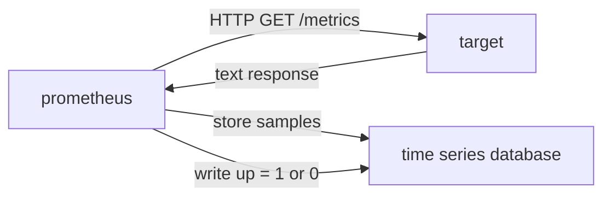

# Naming, Units And Scrape Limits

A query returns the data that Prometheus stored, and the data depends on two things the query cannot control: what the metric is called and how often it was scraped. This part covers the naming conventions that make a metric readable without documentation, and the limits that the scrape process puts on every value.

## Naming Conventions

A Prometheus metric name has three parts: a prefix for the application or subsystem, a description of what is measured and a unit. The name `shop_request_duration_seconds` is built this way. The name uses only lowercase letters, digits and underscores. The prefix `shop` tells which application exposes it.

Use base units: seconds for time, bytes for size, meters for length, and ratios from 0 to 1 instead of percentages. A metric in milliseconds, such as `shop_latency_ms` in the playground, forces every reader and every dashboard to convert, and it breaks the rule that the same quantity has one unit everywhere. The convention exists so that a query can combine metrics without hidden conversions.

A counter name ends in `_total`. A name of a histogram or summary describes the observed quantity and carries the unit, and Prometheus adds `_bucket`, `_sum` and `_count`. A name never contains the label names or label values, because labels carry that information. The name `shop_requests_user_alice_total` is wrong, and the label `user` is also unsuitable for the reasons of cardinality.

Read the real names. Select the cluster and define a helper that fetches the metric names with their types.

<!-- astrona:playground:renew -->

```sh
export KUBECONFIG="$(astrona kubeconfig ats-047-playground-010-02)"
test "$(kubectl config current-context)" = "kind-astro-ats-047-playground-010-02" || exit 1
```

```sh
shop_types() {
  kubectl -n starfleet exec shuttle -- python -c 'import urllib.request; print(urllib.request.urlopen("http://shop-a:8080/metrics", timeout=8).read().decode())' | grep '^# TYPE'
}
shop_types
```

Check each name against the rules above. One metric of the shop breaks the unit rule, and its type line shows that it is a gauge with a name that ends in a unit other than seconds.

## What A Scrape Is

A scrape is one HTTP request from Prometheus to the metrics path of a target. The scrape interval sets how often it happens, and the scrape timeout sets how long Prometheus waits for the response. The playground interval is two seconds. Many real deployments use fifteen seconds or one minute. After a successful scrape, Prometheus stores each sample with the timestamp of the scrape.



The diagram shows that every scrape also writes the `up` series, whether it succeeded or failed.

## The up Metric

For every scrape, Prometheus writes a synthetic series named `up` with the labels `job` and `instance`. The value is 1 when the scrape succeeded and 0 when it failed. Check it before you trust any other series of a job:

```sh
prom_query() {
  kubectl -n starfleet exec shuttle -- python -c 'import sys,urllib.parse,urllib.request; print(urllib.request.urlopen("http://prometheus:9090/api/v1/query?"+urllib.parse.urlencode({"query":sys.argv[1]}),timeout=8).read().decode())' "$1"
}
prom_query 'up{job="shop"}'
prom_query 'scrape_duration_seconds{job="shop"}'
```

A value of 0 for `up` means a failed scrape: the target is down, unreachable or too slow. The series `scrape_duration_seconds` shows how long each scrape took, which helps you choose the scrape timeout. Prometheus also writes `scrape_samples_scraped`, the number of samples per scrape, which is a direct view of the cardinality of a target.

## What A Scrape Cannot See

A scrape sees the state of the target at one moment. Everything that happens between two scrapes is visible only through counters and histograms, which accumulate. A gauge that rises and falls between two scrapes leaves no sample. With a scrape interval of one minute, a ten-second spike in a gauge is likely invisible.

A counter keeps the increments, but the events cannot be placed in time more precisely than the interval. If a process crashes, the increments since the last scrape are lost. A short-lived process that finishes between two scrapes may never be scraped at all.

## Staleness And Missing Data

When a target disappears, or when a series is absent from a scrape that succeeded, Prometheus marks the series as stale. A stale series returns no value in an instant query. For a series that is not stale, an instant query returns the latest sample that is no older than five minutes, the default lookback delta. A query therefore never invents a value for a stale series, and a missing result differs from zero.

Try it. Stop the traffic and see how a rate behaves. Scaling the traffic generator to zero stops all requests, but the counters still exist.

```sh
kubectl -n starfleet scale deployment/traffic --replicas=0
```

Wait two minutes, and then run the expression `sum(rate(shop_http_requests_total[1m]))`. The series are still scraped, so the counters are present, and the rate is expected to be 0, not empty. Scale the traffic back with `kubectl -n starfleet scale deployment/traffic --replicas=1` when you finish.

## Window And Interval Together

The window of a range selector must contain at least two samples, so it must be larger than the scrape interval. A window of one minute with a two-second interval holds about thirty samples. A window of one minute with a one-minute interval holds one or two, and `rate()` may return nothing. The rule of thumb is at least four scrape intervals.

## What You Know Now

You can read a metric name for its subsystem, quantity and unit, and you can spot a unit that breaks the convention. You know that `up` shows the health of each scrape, that a scrape sees only one moment and that a stale series returns nothing instead of zero. You can read a metric result and say what it can and cannot prove.

## Common pitfalls

> [!WARNING]
> Do not use percentages or milliseconds in metric values, because the convention is ratios and base units. Do not read an empty result as zero. Do not use a range window shorter than a few scrape intervals. Do not trust a series of a job before you check that `up` is 1 for its targets.
