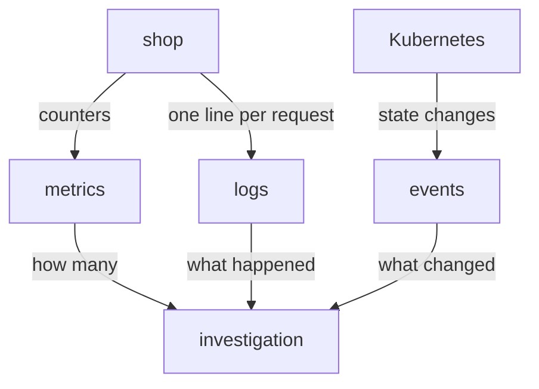

# Metrics, Logs And Events Compared

When a service misbehaves, an operator needs evidence. A single kind of data rarely holds all of it. This part shows the three kinds of data that a running application produces, what each one contains, and which question each one answers. It uses one shop application, so every statement can be checked on the same system.

## Three Kinds Of Data

A metric is a number that describes a group of events over time. The application keeps a counter, such as the number of requests with status `500`, and a Prometheus server reads the counter at a fixed interval and stores each value with a timestamp. A metric sample has no detail about a single request. It only says how many.

A log record is a text record that an application writes for one event. The record says what happened, when it happened and in which component. A log holds detail about one request, such as the route, the user and the duration, but it does not count anything on its own. A person or a tool must count the records.

An event is a record that a system creates when something changes. In Kubernetes, the scheduler, the kubelet and the controllers create event objects that say a pod was scheduled, a container started or an image could not be pulled. An event describes a change in the state of a resource. It does not describe a request.

## Which Question Each Kind Answers

Each kind answers a different question. A metric answers how many and how often: how many requests failed in the last minute, and on which route. A log answers what happened in one case: which user sent the failed request and how long it took. An event answers what changed and when: which pod started and which container was restarted.



The diagram shows that the application produces metrics and logs, that Kubernetes produces events, and that an investigation uses all three.

The three kinds do not replace each other. A counter cannot tell you why one request failed, and a single log record cannot tell you how many requests failed. The strongest evidence comes from joining them: the metric finds the problem and the route, the log explains one example, and the event shows what changed in the cluster around that time.

## The Shop Application In The Playground

The playground runs a `shop` Deployment in the `starfleet` namespace. It serves `/work` for requests, `/metrics` for Prometheus and writes JSON log records to standard output. A `traffic` Deployment sends about two requests per second. One request in six fails with status `500`, and every failure uses the route `/checkout`. The `shuttle` pod is a plain Python container for sending requests inside the cluster.

Select the cluster. The first command sets the kubeconfig (the file that tells `kubectl` which cluster and credentials to use) and the second stops if the context is wrong.

<!-- astrona:playground:renew -->

```sh
export KUBECONFIG="$(astrona kubeconfig ats-047-playground-020-01)"
test "$(kubectl config current-context)" = "kind-astro-ats-047-playground-020-01" || exit 1
```

## Metrics: Numbers Without Detail

Fetch the metrics text of the shop. The endpoint returns plain text, one line for each series.

```sh
kubectl -n starfleet exec shuttle -- python -c 'import urllib.request; print(urllib.request.urlopen("http://shop:8080/metrics", timeout=8).read().decode())'
```

The output holds `shop_http_requests_total` with the labels `route` and `status`, and two counters about the log records. Every line is a total since the process started. No line says which user sent a request or how long one request took.

## Logs: Detail Without Totals

Read the last lines that the shop wrote to standard output. The container runtime stores what a container writes to standard output, and `kubectl logs` reads it.

```sh
kubectl -n starfleet logs deployment/shop --tail=5
```

Each line is one JSON object. It has the route, the status, the duration and the user of one request. You can read what happened to that request, but you cannot tell from five lines how many requests failed in the last minute. The shop also does not log every request: it logs every failed request and one successful request in five.

## Events: Changes In The Cluster

List the events of the namespace, oldest first.

```sh
kubectl -n starfleet get events --sort-by=.metadata.creationTimestamp
```

The list shows the creation of the pods and containers of the namespace: scheduling, pulling images and starting containers. These lines describe the cluster, not the shop requests. An event tells you that the shop container started at a certain time, which helps when a metric changes at that time.

## How The Three Differ In Shape And Cost

The three kinds also differ in how they grow. A metric grows with the number of series, which is the number of distinct label combinations, and not with the number of requests. A counter that is read every two seconds costs the same whether the shop serves ten requests or ten million. A log grows with the number of records, so more traffic means more lines to write, ship and store.

Events grow with the number of changes in the cluster. A stable cluster creates few events, and a cluster with crashing pods creates many. Kubernetes keeps events for a limited time, and the log of a container is also limited by rotation on the node. A metric is stored by Prometheus for the retention period that the administrator configured.

These differences explain the use of each kind. Use metrics for alerts and for questions about the whole population of requests, because their cost stays low and they cover every request. Use logs for questions about single cases, because they hold detail. Use events for questions about the lifecycle of resources.

## What You Know Now

You know that metrics count, logs describe single cases and events record changes. You also know where each one comes from in the playground: the `/metrics` endpoint, standard output of the container and the Kubernetes API. The open question is what makes a log record useful, and how one request is found in a stream of records.

## Common pitfalls

> [!WARNING]
> Do not try to rebuild counts from a few log lines, and do not try to find the cause of one failure in a counter. A log or an event that you cannot find does not prove that nothing happened, because each source keeps only part of the history.
