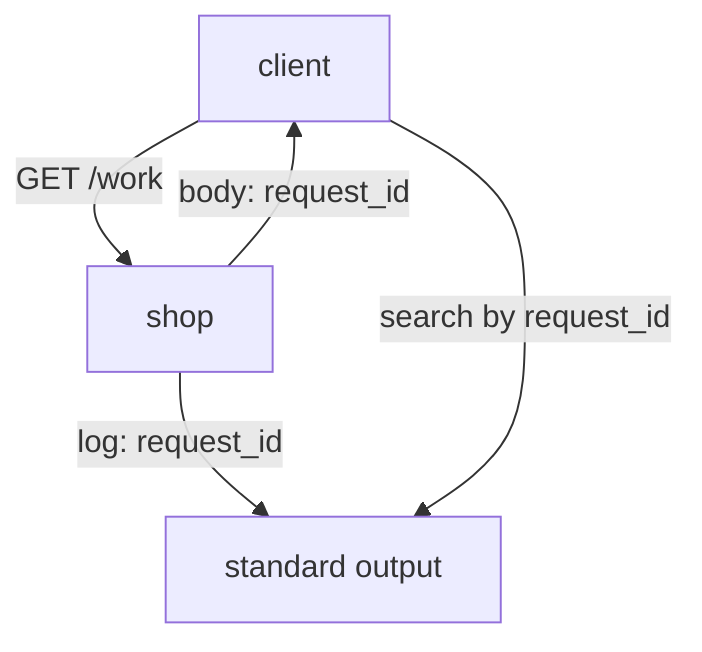

# Structured Log Records And Request Identifiers

A log is only useful when you can find the record you need. A free-text line such as `checkout failed for bob` is easy to write and hard to search. This part explains structured logging, the fields that a good record needs, and how a request identifier lets you go from one response to the one record that describes it.

## Free Text And Structured Records

An unstructured log line is a sentence. A tool that wants the route or the duration has to cut the text with a pattern, and the pattern breaks when someone changes the wording. A structured log record writes the same facts as named fields, usually in JSON (JavaScript Object Notation), one object on each line. A tool reads the field `route` directly, with no pattern.

The shop writes one JSON object per line. A record has this shape (the values here only show the types):

```text
{"duration_ms": 20.4, "email": "<user>@example.test", "instance": "<pod>", "level": "error", "message": "request completed", "request_id": "<12 characters>", "route": "/checkout", "sample_every": 1, "service": "shop", "status": 500, "ts": "<UTC time>", "user_id": "<user>"}
```

Each field has a job. The next sections go through them in groups.

## Time, Level And Message

The field `ts` holds the time of the record in UTC (Coordinated Universal Time), in ISO 8601 format with milliseconds. A record without a time cannot be placed on a timeline, and a time without a zone is ambiguous. UTC avoids the question of which time zone the writer used. The container runtime can also add its own timestamp, which `kubectl logs --timestamps` prints before each line.

The field `level` is the severity. The shop uses `info` for a successful request and `error` for a failed one. Common levels are `debug`, `info`, `warn` and `error`. A level lets you filter, but it does not describe the impact: an `error` record for a harmless retry and an `error` record for a failed payment look the same until you read the other fields. The field `message` is a short fixed text. A fixed message is easier to search than one that has the values mixed into the sentence.

## Who Wrote It And What It Was About

The field `service` names the application and `instance` names the pod, here the pod name from the host name of the container. When several pods run the same service, `instance` tells you which pod wrote the record. A pod name changes when the pod is replaced, so the name identifies one run of the container and not the service for all time.

The fields `route`, `status`, `duration_ms` and `user_id` describe the request itself. These fields are the detail that a counter does not have. They are why you read a log record after a metric shows a problem.

## The Request Identifier

The field `request_id` is a value that the shop generates for each request. The shop returns the same value in the response body and writes it in the log record. That makes it a correlation identifier: a value that appears in more than one place and links the places.



The diagram shows that the client gets the identifier in the response and uses it to find the record that the shop wrote.

Define a helper that sends a request from the `shuttle` pod and prints the HTTP status code and the body. A failing request returns status `500`, and the Python client raises an error for that status, so the helper catches the error and prints the body as well.

<!-- astrona:playground:renew -->

```sh
export KUBECONFIG="$(astrona kubeconfig ats-047-playground-020-01)"
test "$(kubectl config current-context)" = "kind-astro-ats-047-playground-020-01" || exit 1
```

```sh
send_request() {
  kubectl -n starfleet exec shuttle -- python -c '
import sys, urllib.error, urllib.request
try:
    reply = urllib.request.urlopen(sys.argv[1], timeout=8)
    print(reply.status, reply.read().decode())
except urllib.error.HTTPError as error:
    print(error.code, error.read().decode())
' "$1"
}
```

Send a failing request for the route `/checkout` with a user name of your own:

```sh
send_request "http://shop:8080/work?route=/checkout&status=500&user=reader"
```

The output has the status code `500` and a JSON body with the fields `request_id`, `route` and `status`. The shop returns the status that you asked for, so the request counts as a failure in the metrics and in the log.

## Find The Record

Search the log for the identifier. Replace `<REQUEST_ID>` with the value from the response.

```sh
kubectl -n starfleet logs deployment/shop --tail=500 | grep '<REQUEST_ID>'
```

The output is one line, the record of your request. The fields `route`, `status` and `user_id` match what you sent, and `level` is `error`. The option `--tail=500` sets how many of the last lines to read. Set it on purpose, because a default limit can cut off an older record and make a search return nothing.

Because each record is one line, `grep` is enough to find one record. A tool that parses JSON can also select a single field from every line.

## Why The Identifier Must Be Unique And Stable

A request identifier must be different for every request and must be the same everywhere the request is described. If two requests share one identifier, a search returns two records and you cannot tell which belongs to your response. If the log and the response carry different values, the join is impossible. In a system with several services, the first service creates the identifier and passes it to the others in a request header, so that all records of one request carry the same value.

The identifier is also not a metric label. A label with a new value for each request would create a new time series for each request, and the number of series would grow without a limit. The identifier belongs in the log record, where one more field costs one more value on one line.

## What You Know Now

You know that a structured record has named fields, that time, level, service, instance and message locate the record, and that the request identifier links a response to its record. You can find the record of a request with `kubectl logs` and `grep`. The open question is what the cluster itself records about the shop, such as the start of a container.

## Common pitfalls

> [!WARNING]
> Set `--tail` on purpose when you search, because a default limit can hide an older record. A successful request is logged only one time in five, so a request with status `200` may have no record: use a failing request when you need a record to exist. Do not put the request identifier in a metric label.
