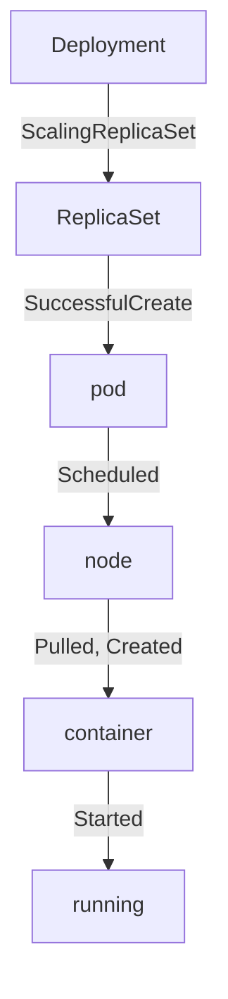

# Kubernetes Events

A log record shows what an application did. It does not show what the cluster did around the application: when a pod was placed on a node, when an image was pulled or when a container restarted. Kubernetes records those changes as events. This part explains what an event contains, who creates it and how long it lives, so that you can use events as timeline evidence and know where they stop.

## What An Event Is

An event is a Kubernetes API object of the kind `Event`. A component of the cluster creates it when something happens to another object, such as a pod. The object stores the facts of the change in fields, and the API server keeps it like any other resource. You read events with `kubectl get events` or at the end of `kubectl describe`.

Events are namespaced. An event about a pod in the `starfleet` namespace lives in the `starfleet` namespace. Events about cluster-wide objects, such as nodes, are stored in the `default` namespace. Always name the namespace when you list events, or you will see only the events of the current namespace.

## The Fields Of An Event

The main fields of an event are listed below.

- `type`: `Normal` for an expected change, or `Warning` for a change that may need attention.
- `reason`: a short, fixed word in CamelCase that names the change, such as `Scheduled`, `Pulled`, `Started` or `BackOff`.
- `message`: a sentence with the details of this case.
- `involvedObject`: the kind, name, namespace and identifier of the object that the event is about.
- `source` or `reportingComponent`: the component that created the event, such as `default-scheduler`, `kubelet` or `deployment-controller`.
- `count`, `firstTimestamp` and `lastTimestamp`: how many times the same event happened and when it first and last happened.
- `metadata.uid`: the identifier of the event object itself.

The `reason` is the field to filter on, because it is a fixed word and the `message` is free text. The `involvedObject` field is the join to the object. An event does not carry a request identifier, because it is about a resource and not about a request.

## Who Creates The Events For A Pod

When a Deployment creates a pod, several components each create events for their own step. The deployment controller scales a ReplicaSet and creates a `ScalingReplicaSet` event on the Deployment. The ReplicaSet controller creates the pod and records `SuccessfulCreate` on the ReplicaSet. The scheduler picks a node and records `Scheduled` on the pod. The kubelet on that node then records `Pulling` and `Pulled` for the image, `Created` for the container and `Started` when the container runs.



The diagram shows the order of the common reasons and that different components create them. The field `source` or `reportingComponent` tells you which component spoke.

## Read The Events

Select the cluster and list the events of the `starfleet` namespace in creation order. The sort key `.metadata.creationTimestamp` works for every event, also for events that have no `lastTimestamp`.

<!-- astrona:playground:renew -->

```sh
export KUBECONFIG="$(astrona kubeconfig ats-047-playground-020-01)"
test "$(kubectl config current-context)" = "kind-astro-ats-047-playground-020-01" || exit 1
```

```sh
kubectl -n starfleet get events --sort-by=.metadata.creationTimestamp
```

The output has the columns for the age, the type, the reason, the object and the message. Find the line with the reason `Started` for the pod of the `shop` Deployment. Pod names of a Deployment start with the Deployment name, then a hash and a random suffix.

## Filter By Object

A busy namespace has many events. A field selector keeps only those that match a field of the event. The selector below keeps events whose involved object is a pod:

```sh
kubectl -n starfleet get events --field-selector involvedObject.kind=Pod --sort-by=.metadata.creationTimestamp
```

The same selector syntax works for `reason` and `type`, for example `--field-selector type=Warning`. A healthy playground may return no warning at all, and an empty list is a valid answer.

## See The Whole Object

The table hides most fields. Print one event as JSON to see the fields that the table leaves out, such as the uid and the reporting component:

```sh
kubectl -n starfleet get events -o json
```

In the output, find an item with `"reason": "Started"` and read its `involvedObject`, its `metadata.uid` and its counters. Every item is a full Event object, and you could process the list with a script in the same way you process any other resource.

## Create New Events

Events appear when something changes. Delete the pod of the shop and the Deployment will create a replacement. The old pod disappears, and new events appear for the new pod.

```sh
kubectl -n starfleet delete pod -l app=shop
kubectl -n starfleet rollout status deployment/shop --timeout=120s
kubectl -n starfleet get events --sort-by=.metadata.creationTimestamp
```

The new pod has a new name, and the list now has a second `Scheduled` and a second `Started` event with the new name. Events of the old pod can still be in the list, because deleting an object does not delete its events. The new pod also starts a new log, so the old records of the shop are no longer available with `kubectl logs`.

## Retention And Limits

Events are not a permanent history. The API server deletes events after a time to live of one hour by default, which the administrator can change with the `--event-ttl` setting of the API server. After that time the event is gone, and an incident that started two hours ago has no events left to read.

Kubernetes also combines repeated events. When the same event happens again, the component increases `count` and updates `lastTimestamp` instead of creating a new object. A crash loop therefore shows one `BackOff` event with a large count and not hundreds of lines. Events can also be dropped under load. An event is evidence that a change happened. A missing event does not prove that a change did not happen, and the list of events is not an audit log of every action.

## What You Know Now

You know that events record changes of resources, that they have a type, a reason, an involved object and a reporting component, and that you can filter them with `kubectl`. You know that events live for about one hour and that repeated events are combined. The three kinds of data are now in place: metrics count, logs describe requests and events describe changes.

## Common pitfalls

> [!WARNING]
> Do not read events from one namespace and assume the cluster is quiet, because node events are in the `default` namespace. Do not rely on events for an incident that is older than the retention time, which is one hour by default. Do not read the `message` field with a script: filter on the `reason` and the `involvedObject` instead.
