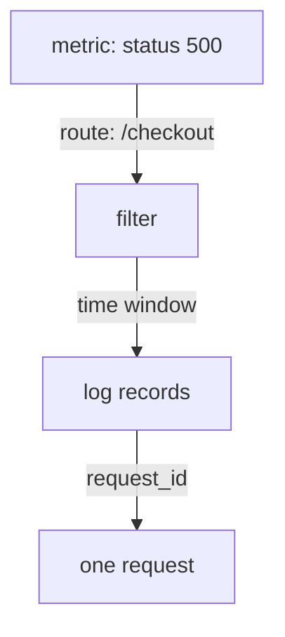

# Correlating Metrics And Logs

A metric tells you that something is wrong and where. A log record tells you what happened in one case. Correlation is the work of joining the two so that the number leads you to the examples. This part shows the fields and the time window that make the join possible, and explains why a join gives a candidate explanation and not a proof.

## From A Number To A Group Of Records

Start from a metric symptom. A counter of failed requests rises, and you want to know which requests failed. The metric already holds labels: the route, the status and the instance that Prometheus added when it scraped. Each label is a filter that you can apply to the logs too, if the log records carry the same facts as fields.

The shop makes this possible on purpose. The metric `shop_http_requests_total` has the labels `route` and `status`, and every log record has the fields `route` and `status`. A symptom such as "status 500 on `/checkout`" is a filter on the metric and a filter on the logs with the same words.



The diagram shows the steps: the metric gives the filter and the window, the filter selects records and the request identifier picks one request.

## Find The Symptom In The Metric

Select the cluster and define a helper that sends a PromQL (Prometheus Query Language) expression to Prometheus.

<!-- astrona:playground:renew -->

```sh
export KUBECONFIG="$(astrona kubeconfig ats-047-playground-020-02)"
test "$(kubectl config current-context)" = "kind-astro-ats-047-playground-020-02" || exit 1
```

```sh
prom_query() {
  kubectl -n starfleet exec shuttle -- python -c 'import sys,urllib.parse,urllib.request; print(urllib.request.urlopen("http://prometheus:9090/api/v1/query?"+urllib.parse.urlencode({"query":sys.argv[1]}),timeout=8).read().decode())' "$1"
}
prom_query 'sum by (route) (rate(shop_http_requests_total{status="500"}[1m]))'
```

The result has one series, for the route `/checkout`, with a value near 0.3 failed requests per second. The other routes do not appear, because they have no series with status `500`. The metric has told you the route and the size of the problem. It cannot tell you why the requests failed.

## Select The Records

Now read the log for the same route and status. The window must cover the time of the symptom. The option `--since=5m` keeps records from the last five minutes, and `--tail=-1` removes the line limit so that the window decides what you see.

```sh
kubectl -n starfleet logs deployment/shop --since=5m --tail=-1 | grep '"route": "/checkout"' | grep '"status": 500' | tail -3
```

The output has the last three failed `/checkout` records of the window. Each shows the user, the duration and the request identifier of one failed request. The identifier lets you take one record and follow that request in other sources, such as a trace or another service log.

## Do The Numbers Agree

The metric counts every request, and the shop logs every failed request. For failures, the two sources should therefore agree on the size of the group. Ask Prometheus for the increase over five minutes, and count the failed records of the same window.

```sh
prom_query 'sum(increase(shop_http_requests_total{status="500"}[5m]))'
kubectl -n starfleet logs deployment/shop --since=5m --tail=-1 | grep -c '"level": "error"'
```

The two numbers are close and usually not equal. The function `increase()` extrapolates to the edges of the window, and the log window has its own edges. The scrape also happens every two seconds, so the last requests may be in the log and not yet in a sample. A small difference at the edges is normal. A large difference means that one source misses data.

## Use The Same Names In Both Sources

A join works only when both sources use the same words. If the metric label is `route` and the log field is `path`, you must translate by hand every time, and a typing mistake gives a wrong result without an error. The same holds for values: a route template such as `/items/{id}` in the metric and a real path such as `/items/48213` in the log are different strings.

Agree on field names across all services, and write the same names in metric labels and log fields where they mean the same thing. Keep identity fields stable as well: the service name, the instance and the version should be the same in the metric, in the log and in the events of the pod. Then one filter works everywhere.

Some facts belong only in logs. The user and the request identifier are examples. A metric label with a new value for each user or each request would create a new time series for each value, so these facts go in the record and not in the label.

## Time Is The Hardest Join

Records and samples carry times from different clocks. A Prometheus sample has the time of the scrape. A log record has the time that the application wrote. Container clocks on different nodes can drift apart, and a time zone that is not UTC moves a record by hours. For these reasons, read an interval wider than the symptom, and use the same time zone for everything.

Instance identity matters too. A Deployment gives each replacement pod a new name, so a replacement creates a new pod identity. A metric series for the old pod ends and a new series starts. If you filter logs by the old pod name after a restart, you get nothing, although the application is still logging under a new name.

## Correlation Is Not Cause

Suppose a deployment event appears two minutes before the failures start. The event is a candidate explanation, and it deserves a look. Another change at the same time, such as a failing dependency, could be the cause, and the two could be unrelated. Two facts that happen at the same time show a relation in time. They do not show that one caused the other.

A good investigation names a hypothesis and then looks for a record that supports or rejects it. If the hypothesis is "the checkout route fails after the deployment", look for failures before the deployment as well. A record of failed `/checkout` requests from the hour before the deployment rejects the hypothesis.

## What You Know Now

You know how to turn a metric symptom into a filter on route, status and time, how to select the matching log records, and how to check that the counts of the two sources agree. You know that clocks and pod names can break the join, and that a match in time is not proof of a cause. The open question is what happens to the records between the application and the search, and which records never arrive.

## Common pitfalls

> [!WARNING]
> Do not read a window that is exactly as wide as the symptom, because clocks and scrape times differ. Do not filter by the name of a pod that was replaced. Do not treat an event that happened shortly before a symptom as the proven cause.
