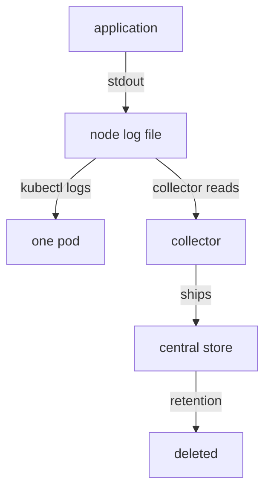

# Collection, Sampling And Retention

A record that the application wrote is not yet a record that you can search. Between the application and a search there are stages, and each stage can lose records or keep them for a limited time. This part follows a record along those stages, shows how sampling removes records on purpose, and shows how that changes the answers that logs can give.

## The Path Of A Log Record

A containerised application writes its log to standard output. The container runtime captures that output and writes it to a file on the node that runs the container. The kubelet, the agent of Kubernetes on each node, manages those files. The command `kubectl logs` asks the API server, which asks the kubelet, which reads the file of the container.

Longer storage needs a collector. A collector is a program, often one pod on every node, that reads the node log files and sends the records to a central store. The store indexes the records and keeps them for a retention period. A search in the central store sees only what the collector shipped and what the store has not yet deleted.



The diagram shows that `kubectl logs` and a central search read from different places, and that the central store removes records at the end of retention.

## Where Records Are Lost

Each stage has its own limit. The kubelet rotates the log file of a container: when the file reaches a size limit (10 MiB by default), the kubelet starts a new file and keeps only a limited number of old files (five by default). `kubectl logs` reads the current file, so a busy container can push old records out in minutes. When a pod is deleted, the node removes its log files, and the records are gone unless a collector shipped them first.

The collector can fall behind or drop records when the store is not reachable or when it is over capacity. A filter in the collector can drop records on purpose, such as all `debug` records. The store deletes records at the end of its retention period. A search that finds nothing therefore reflects the coverage of one stage and not the full history.

## Sampling On Purpose

Sampling means keeping only some records of a kind. It reduces volume and cost while keeping a representative part. The shop uses a simple rule. It writes a record for every failed request, and for every fifth successful request. The field `sample_every` in each record states the rule: `1` means all records of that kind are kept, `5` means one record in five.

Failures are kept in full because they are rare and each one may need investigation. Successes are sampled because there are many and each one adds little. A sampling rule that drops failures would save more space and would defeat the purpose of the log.

Select the cluster and define the query helper. Then read the sampling counters of the shop.

<!-- astrona:playground:renew -->

```sh
export KUBECONFIG="$(astrona kubeconfig ats-047-playground-020-02)"
test "$(kubectl config current-context)" = "kind-astro-ats-047-playground-020-02" || exit 1
```

```sh
prom_query() {
  kubectl -n starfleet exec shuttle -- python -c 'import sys,urllib.parse,urllib.request; print(urllib.request.urlopen("http://prometheus:9090/api/v1/query?"+urllib.parse.urlencode({"query":sys.argv[1]}),timeout=8).read().decode())' "$1"
}
prom_query 'sum by (level) (shop_log_records_total)'
prom_query 'shop_log_records_sampled_out_total'
```

The first query returns the number of records that the shop wrote for each level. The second returns the number of successful requests that wrote no record. The shop counts both on purpose, so that the metrics show how much of the traffic the log holds. A system that samples its logs should expose such numbers.

## Measure What The Log Holds

Divide the number of `info` records by the number of requests with status `200`. Both are counters, so the sums have the same empty label set and the division matches.

```sh
prom_query 'sum(shop_log_records_total{level="info"}) / sum(shop_http_requests_total{status="200"})'
```

The result is close to 0.2, because one successful request in five writes a record. The result is slightly below 0.2 when the counter has not yet reached the next multiple of five. For failed requests the same division with `level="error"` and `status="500"` gives 1.

## Sampling Changes The Answers

Count the records of the last 200 lines and the share of `error` records:

```sh
kubectl -n starfleet logs deployment/shop --tail=200 | grep -c '"message": "request completed"'
kubectl -n starfleet logs deployment/shop --tail=200 | grep -c '"level": "error"'
```

The share of error records in the log is about one half, because the log holds every failed request and a fifth of the successful ones. The real failure ratio of the traffic is one request in six, which the counter gives:

```sh
prom_query 'sum(rate(shop_http_requests_total{status="500"}[1m])) / sum(rate(shop_http_requests_total[1m]))'
```

The log shows a share near 0.5 and the metric shows a ratio near 0.17. The metric is right, because it counts every request, and the log is biased by sampling. If you must count from sampled logs, multiply each record by its `sample_every` value: the `info` records count five times, and the `error` records count once.

## Retention Is A Decision

Retention is how long a source keeps its data: the node keeps a limited amount of file, a store keeps records for days or weeks, and Kubernetes keeps events for one hour. Choose the retention for each source from the questions that people must answer. If incidents are usually investigated the next day, a week is enough. If an audit asks about last quarter, the metric or the log must be kept for the quarter, and that has a storage cost.

Document the sampling rule and the retention next to the data. A missing record is a statement about coverage, not a proof that the action never happened.

## What You Know Now

You know the stages between an application and a log search, where each stage loses records and how sampling removes them on purpose. You can measure the part of the traffic that the log holds and you know that a failure ratio from sampled logs is wrong. The open question is what the records contain, and whether they should hold everything the application knows.

## Common pitfalls

> [!WARNING]
> Do not calculate a failure ratio from sampled logs: use a counter, or weight each record by `sample_every`. Do not assume that a search that finds nothing means nothing happened: check the coverage of the stage that you searched. Do not read `kubectl logs` as the full history of a pod, because rotation and pod replacement remove records.
