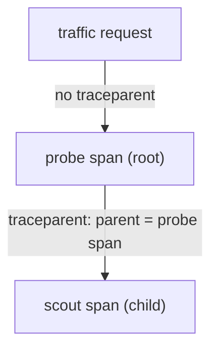

# Parent-Child Structure, Timing And Self Time

A trace is useful because it shows where the time of a request went. Reading it correctly takes more than finding the longest bar. A parent span lasts as long as its own work plus everything it waits for, so the longest span is often not the one that is slow. This part explains how spans nest, how to calculate the time a span spends on its own work, and why durations cannot simply be added together.

## How spans form a tree

Each span names its parent with the field `parent_span_id`. A span whose parent id is empty is the root. All the other spans point at one span that started them, so the spans of a trace form a tree. In the example application, the root of a request that came from `traffic` is the `probe` span, and the `scout` span is its only child.

The tree records causes, not only order. The `scout` span exists because `probe` called `scout` while it handled the request. That is a statement about which operation started which, and it does not say that the child is the reason the request was slow or that it failed. A tree shows structure. Whether a span is responsible for a problem comes from its timing, its status and other evidence.

A parent span starts before its children and, for synchronous calls, ends after them. The parent waits for each call to return. The duration of the parent therefore contains the durations of the calls it waited for.

## Self time

The self time of a span is the part of its duration that its children do not explain. For a span with one child, it is the duration of the span minus the duration of the child. For a span with several children that run one after the other, subtract the sum of the child durations. For children that overlap, subtract the length of the time covered by at least one child, not the sum of their durations.

Self time is where a span did its own work, or waited for something that has no span. It is the number to compare between spans when you look for the slow part of a request. A long `probe` span with a short self time says that `probe` spent its time waiting for its child.

## Send a request with a slow child

The `probe` service accepts a query parameter `child_delay`. It is the number of seconds that `scout` waits before it replies. Define a helper that sends a request to `probe` from the `shuttle` pod, with a `traceparent` value so that both services record spans.

<!-- astrona:playground:renew -->

```sh
send_request() {
  kubectl -n starfleet exec shuttle -- python -c 'import sys, urllib.request; r = urllib.request.Request("http://probe:8080" + sys.argv[1], headers={"traceparent": sys.argv[2]}); print(urllib.request.urlopen(r, timeout=8).read().decode())' "$1" "$2"
}
send_request '/work?child_delay=0.3' 00-1af7651916cd43dd8448eb211c80319c-b7ad6b7169203331-01
```

The response contains the fields of the `probe` span and, under `child`, the fields of the `scout` span. Compare the two `duration_seconds` values. The `scout` value is at least 0.3, because of the delay. The `probe` value is larger by the time `probe` spent on its own: its own delay of 0.01 seconds plus the network call.

## Read the durations from the logs

The span records in the logs hold the same numbers. Print the span line of each service for this trace id.

```sh
kubectl -n starfleet logs deployment/probe --tail=2000 | grep 1af7651916cd43dd8448eb211c80319c | grep '"event": "span"'
kubectl -n starfleet logs deployment/scout --tail=2000 | grep 1af7651916cd43dd8448eb211c80319c | grep '"event": "span"'
```

Take `duration_seconds` of the `probe` span and subtract `duration_seconds` of the `scout` span. The result is the self time of `probe`. The self time of `scout` is its whole duration, because it has no children. The slow request spends almost all of its time in `scout`, even though the root span is the longest bar in the trace.

## Why durations are not simply added

Suppose a service calls two dependencies and each call takes 300 milliseconds. If the service makes the calls one after the other, the request waits 600 milliseconds for them. If it starts both calls at the same time and waits for both, the request waits about 300 milliseconds. The two child spans look the same in both cases, and only their start times show the difference.

For this reason, read start times together with durations. Children that overlap in time share the same wait, so the sum of their durations overstates the time they added to the parent. The critical path is the chain of spans that determined when the request finished. Speeding up a span that is not on the critical path does not make the request faster.

## Time that no span explains

A parent span can last much longer than its children, and the extra time is not always the parent's own computation. The parent can have waited for a thread, for a connection from a pool, for a lock or for a call that has no span. A long self time says that the time is inside the parent but outside its recorded children. It is a question to answer with other evidence, such as metrics for queue depth, logs or a profile, not a proof that the parent code is slow.

The opposite also happens. A trace with a very short parent and one long child shows that the slow work is in the child, and you can stop looking at the parent. Self time lets you decide which span to examine first.

## A worked calculation

Take a made-up trace to practise the arithmetic. The request span of a service lasts 400 milliseconds. It has two children that run one after the other: a database span of 120 milliseconds and a downstream call span of 200 milliseconds. The self time of the request span is 400 - 120 - 200 = 80 milliseconds. That is the time in the request handler itself and in any call without a span.

Now change the example so that the same two children start at the same moment and both end by the time the longer one ends. The covered time is 200 milliseconds, not 320. If the request span still lasts 400 milliseconds, its self time is 200 milliseconds, not 80. The same child durations lead to a different conclusion, and only the start and end times tell you which case you have.

The diagram shows the tree of the example application:



The diagram shows that the `probe` span is the root and the `scout` span is its child, linked by the parent id that `probe` sends in the `traceparent` header.

## Status and errors in a span

A span carries a status. A span with an error status marks the operation that failed. An error in a child span does not always make the parent fail: the parent can retry, use a fallback or ignore the error. For this reason, a failed child under a successful parent is possible and tells you the parent hid the failure from its caller.

When you search for the cause of a failed request, start from the deepest span that has an error status, because the spans above it often fail only because they received its error. Check the child's own attributes and its timing before you decide that it is the origin.

## Attributes, events and links

Attributes describe one span. This application records `http.method`, `http.route` and `http.target`. Good attributes have a small number of possible values or are identifiers that you need to find a trace. They describe the operation and not the data it processes.

A span can also hold events, which are timestamped notes inside the span, for example "retry started". And a span can hold links, which point to a span in another trace. Links are used when a span is related to another one without being its child, for example when one batch job handles messages that came from many different requests.

You now know how to read the tree and calculate self time. The open question is what happens when the second service does not receive the context, or receives it and drops it.

## Common pitfalls

> [!WARNING]
> The longest span is not automatically the slowest operation, because a parent includes the time of its children. Do not add the durations of children that overlap in time. A parent with a large self time has time that no child explains, which can be queueing or waiting and is not proof of slow code.
