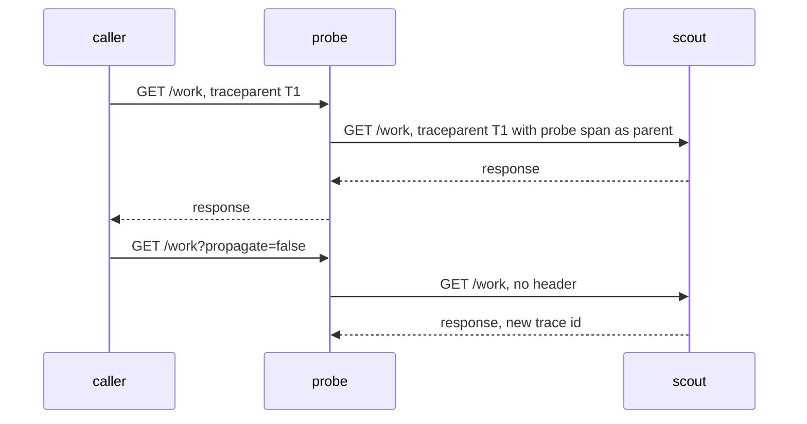

# Context Propagation, Lost Context And Sensitive Attributes

A trace only works when every service passes the trace context to the next one. One service that forgets to do it splits the trace in two, and the second half looks like an unrelated request. This part shows how context moves between services, what a broken chain looks like in the data, and why the attributes of a span need as much care as the other data a service stores.

## What context propagation means

Trace context is the small set of values that lets a service attach its span to the right trace: the trace id, the id of the calling span and the sampled flag. Propagation is the work of carrying those values from one service to the next. The standard way for HTTP is the `traceparent` header. For messages sent through a queue, the context travels in the message headers or metadata.

Three steps make propagation work. The calling service injects the context into its outgoing request. The receiving service extracts the context from the incoming request. The receiving service then creates its span as a child of the caller's span. If any step is missing, the chain breaks.

The `probe` service does all three. It reads the incoming header, creates its own span id, and puts a new `traceparent` header on its call to `scout`. The header it sends holds the trace id it received, its own span id as the parent id, and the sampled flag it received.

## Context that is lost

The `probe` service has a switch for the failure. A request with `propagate=false` makes `probe` call `scout` without a `traceparent` header. Define a helper and send one such request.

<!-- astrona:playground:renew -->

```sh
call_probe() {
  kubectl -n starfleet exec shuttle -- python -c 'import sys, urllib.request; print(urllib.request.urlopen("http://probe:8080" + sys.argv[1], timeout=8).read().decode())' "$1"
}
call_probe '/work?propagate=false'
```

Read the two trace ids in the response: `trace_id` at the top level and `trace_id` inside `child`. They are different. The `scout` service found no header, so it started a new trace. The `parent_span_id` inside `child` is `null`, which marks it as a root span.

Both services wrote `request_completed` lines for the request, and each line holds its own trace id. Nothing in the data tells you that the two traces belong to one request. A person who looks at the `probe` trace sees a `probe` span with a long duration and no child. A person who looks at the `scout` trace sees a request that arrived from nowhere.

## Lost context hides work

An incomplete trace shows less work than happened. In the broken request, the `probe` trace has no child span, so a reader might think that `probe` spent all of its time on its own. The real time is inside `scout`, which sits in a different trace. The wrong conclusion would send the investigation to the wrong service.

Typical causes of lost context are a client library that does not inject the header, a proxy that removes unknown headers, a service that creates a new trace for each incoming request instead of extracting the context, and code that moves work to a thread or task without copying the context. When you see root spans where you expect children, search for one of these causes.

Deploying a collector or a tracing backend does not fix any of them. A collector receives spans that applications send. It does not instrument the applications and it does not add the header to requests.

## Queues and asynchronous work

A message queue breaks the simple call-and-wait model. The producer sends a message and moves on, and the consumer handles it later, maybe minutes later, and maybe in a batch with other messages. A child span that outlives its parent is normal here.

Two designs are common. The consumer can continue the producer's trace by reading the context from the message and creating a span as a child of the producer span. Or the consumer can start its own trace and add a link to the producer span. Links suit batches, because one consumer span can link to the many producer spans that created the messages it handles. Whichever design is used, the context has to be written into the message when it is sent.

## The path of the header

The sequence below shows the header on the two calls of a normal request and on the call of a request with `propagate=false`.



The diagram shows that the second `scout` call has no header, so `scout` answers inside a trace of its own.

## Context and the sampled flag

The header also carries the sampling decision. When `probe` sends the flag `01` to `scout`, `scout` records its span. When `probe` sends `00`, `scout` does not. When the header is lost, `scout` has to make a new sampling decision for its new trace. That decision does not depend on what `probe` decided, so the two services can record different requests, and the recorded traces are incomplete even when both sample at the same rate.

Because of this, a missing child span has two possible explanations that look the same in a trace view. The context was lost and the child started another trace, or the child belongs to the trace but was not sampled. The logs help: a `request_completed` line exists for every request, and its trace id and parent id show whether the service saw the context.

## Sensitive attributes

Span attributes are stored with the trace, often for days, and many people and tools can read them. Treat an attribute as you would treat a log line. Credentials, session tokens, full request bodies and personal data do not belong there.

The example application shows a common mistake. Look at the span of a request from `traffic`. First find one in the log:

```sh
kubectl -n starfleet logs deployment/probe --tail=2000 | grep '"event": "span"' | tail -n 1
```

The `attributes` field has the key `http.target`. Its value is the whole request target, which is the path and the query string. The `traffic` Deployment adds the query parameter `api_key=sk-test-0000` to every request, so the secret is copied into the span. The route (`/work`) is the better attribute, because it has a small number of values and no secrets.

The same care applies to database statements. Record the operation name, such as `SELECT`, and the table, and not the full statement with its parameter values. A trace backend that holds secrets becomes another place to protect, and a leaked secret in a span cannot be recalled from the backend with a configuration change on the application alone.

## Controlling attribute cost

Each attribute adds bytes to every span, and every span is sent over the network and stored. An attribute with unlimited values, such as a user id or a full URL, also makes searching by that attribute less useful, because few spans share a value. Limit the set of attributes to the ones people actually use to find or explain a trace, and prefer values with a small set of possibilities, such as the route, the method and the status class.

You now know how context moves between services, how it breaks, and why attributes need to be chosen with care. The question that remains is which requests get recorded at all, because most deployments trace only a share of their requests.

## Common pitfalls

> [!WARNING]
> A trace that looks complete can still be missing work, because a service that does not pass the context starts a separate trace. A collector does not add the header or instrument the code. Do not put secrets, tokens or full request targets in attributes, and do not assume that a secret in a span can be removed afterwards.
