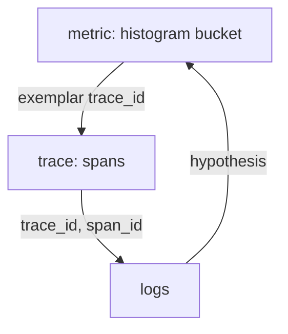

# Reading Metrics, Exemplars, Traces And Logs Together

Each signal answers one kind of question and fails at another. Metrics are cheap and complete but have no detail. Traces have detail but cover only a sample. Logs have detail for any request that wrote one, and they are hard to search without an identifier. An investigation moves between them in a fixed order, and each step has a limit that you must state. This part walks through one investigation and lists what each signal can and cannot prove.

## The order of an investigation

Start with the signal that sees all the traffic, which is the metric. It tells you which service is affected, how big the problem is and when it began. Then use an exemplar to move from the metric to one trace of an affected request. Read the trace to see which span holds the time or the error. Finally read the log lines of that span or trace id to get the detail that the span does not carry, such as an error message.



The diagram shows that the exemplar links the metric to the trace, the ids link the trace to the logs, and the findings send you back to the metric to check how common the problem is.

## Step 1: confirm the symptom with the metric

The histogram `lab_request_duration_seconds` has buckets up to 0.5 seconds. Check what share of `probe` requests take more than 0.25 seconds. The counts in the buckets are cumulative, so the bucket with `le="0.25"` counts all requests up to that duration.

<!-- astrona:playground:renew -->

```sh
prom_query() {
  kubectl -n starfleet exec shuttle -- python -c 'import sys, urllib.parse, urllib.request; print(urllib.request.urlopen("http://prometheus:9090/api/v1/query?" + urllib.parse.urlencode({"query": sys.argv[1]}), timeout=8).read().decode())' "$1"
}
prom_query '1 - sum(rate(lab_request_duration_seconds_bucket{service="probe",le="0.25"}[2m])) / sum(rate(lab_request_duration_seconds_count{service="probe"}[2m]))'
```

The value is the fraction of requests slower than 0.25 seconds. The traffic generator makes every fifth request slow, so the value is close to 0.2. The metric counts every request, sampled or not, so this number is a real measurement and not an estimate from sampled traces.

## Step 2: take an exemplar of a slow request

The metric says that one request in five is slow, and it does not say why. Ask Prometheus for the exemplars of the `probe` buckets for the last five minutes and choose the one with the highest value.

```sh
kubectl -n starfleet exec shuttle -- python -c 'import time, urllib.parse, urllib.request; now = time.time(); q = urllib.parse.urlencode({"query": "lab_request_duration_seconds_bucket{service=\"probe\"}", "start": now - 300, "end": now}); print(urllib.request.urlopen("http://prometheus:9090/api/v1/query_exemplars?" + q, timeout=8).read().decode())'
```

Read the `trace_id` of the exemplar with the highest `value`. Keep it for the next steps. The value is the duration of the whole request, which is the duration of the `probe` span.

## Step 3: read the trace

Search both logs for the trace id and read the two span lines. Replace `TRACE_ID` with the id from the previous step.

```sh
trace_id=TRACE_ID
kubectl -n starfleet logs deployment/probe --tail=5000 | grep "$trace_id" | grep '"event": "span"'
kubectl -n starfleet logs deployment/scout --tail=5000 | grep "$trace_id" | grep '"event": "span"'
```

The `scout` span is the child of the `probe` span. Subtract the duration of the child from the duration of the parent to get the self time of `probe`. The self time of `probe` is small, and the duration of `scout` is close to the whole duration of the request. The metric of `probe` shows the symptom, and the trace shows that the time is spent in `scout`.

## Step 4: check the other evidence

The span of `scout` has no error status, so the slowness is not a failure. The `request_completed` lines in the log carry the same trace id and the status of the request. If the slow request had failed, the status field would say so, and you would look for an error message in the log of the failing service.

Now return to the metric. Check whether `scout` is slow for all requests or only for some, by looking at its own histogram:

```sh
prom_query 'histogram_quantile(0.95, sum by (le) (rate(lab_request_duration_seconds_bucket{service="scout"}[2m])))'
```

The 95th percentile of `scout` is the estimated duration that 95 percent of its requests stay below. If it is above 0.25 seconds, the slow share is large enough to appear in the tail, which agrees with the trace. One trace shows one request, and the histogram shows how common the behaviour is.

## Using the request log as a cross-check

Every request writes a `request_completed` line, sampled or not, and each line holds the trace id, the status and the duration. That makes the log a second source that sees all requests, which is useful when a trace is missing. Count the lines with a status of 500 and compare the count with the counter `lab_requests_total` for the same period. The two numbers should agree, because both count every request. A large difference means that log lines were lost or that the counter was reset by a restart.

The difference between this log line and a span is important. The log line says that a request with that trace id finished, how long it took and how it ended. It does not say what happened inside the request or which child operations it made. Use it to confirm that a request happened when the trace is missing, and use the trace for the structure.

## What each signal proves

A metric proves that something happened to a number of requests, and it proves nothing about one request. An exemplar proves that one sampled request fell into a bucket. A trace proves the structure and timing of the instrumented work of one sampled request. A log line proves what the service chose to write about one request. None of them proves a cause alone. A cause needs a consistent story across the signals, such as: the metric shows a slow share, the traces of that share all spend their time in the same child span, and the child's own metric agrees.

## What can mislead you

Several traps are common. An exemplar is one sample and can be unusual. Sampled traces are not a fair copy of all traffic, so the share of errors among them is not the real error rate. A span with a long self time can hide queueing. A missing span can mean sampling, lost context or a dropped export. Use the metric for any statement about how many, and use the traces only for how and where.

State the limits when you report a finding. A good sentence names the evidence and its scope: "the exemplar trace and the `scout` histogram both show 0.3 seconds in `scout`; this covers sampled requests and the one-minute window of the metric."

You now know how a metric, an exemplar, a trace and a log fit together in one investigation. You can move from a latency symptom to the span that holds the time, and you know which statements each signal supports.

## Common pitfalls

> [!WARNING]
> Do not report an error rate or a latency distribution from sampled traces, because the sample is not representative. Do not call a span the cause only because it is the longest; use self time. Do not rely on one exemplar; confirm with the metric of the suspected service.
