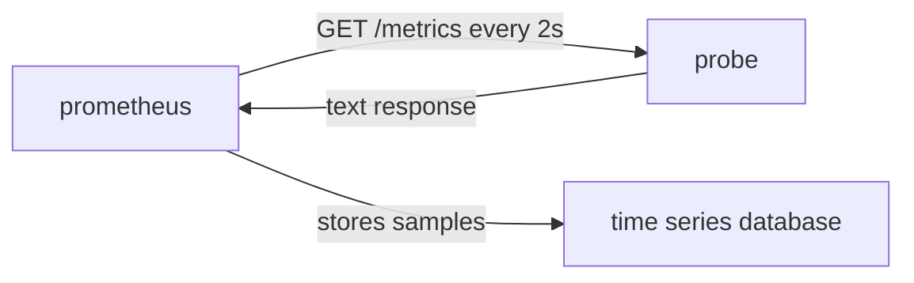

# Pull Collection And Target Health

A monitoring system must answer two questions: what are the values, and are the values current. Prometheus answers both by starting every collection itself. This part shows what a scrape is, which component decides when it happens and what evidence a scrape leaves behind, even when the application has a bug.

## A Scrape Is A Request That Prometheus Starts

Prometheus collects metrics in the pull model. The Prometheus server sends an HTTP (Hypertext Transfer Protocol) request to a target, parses the text in the response and stores every sample with the time of the request. That request is a scrape. A target is one endpoint that Prometheus scrapes, normally an address with a port and the path `/metrics`. A scrape job is a group of targets that share the same settings in the configuration file.

The server decides the schedule. The `scrape_interval` setting says how often a target is scraped, and the `scrape_timeout` setting says how long the server waits for the response. The target does nothing on a schedule. It only keeps its numbers in memory and answers when a request arrives. In the playground, the `probe` application in the `starfleet` namespace is the target, and the Prometheus server scrapes it every two seconds.



The diagram shows that the request flows from Prometheus to the target and that the samples are stored only after the response arrives.

## The Scrape Creates Its Own Evidence

For every scrape, Prometheus adds a few series of its own, next to the series that the application exposes. The most important one is `up`. The value of `up` is 1 when the scrape succeeded and 0 when it failed. A scrape fails when the connection is refused, when the response does not arrive within the timeout, when the status code is not 2xx or when the text cannot be parsed. Prometheus also stores `scrape_duration_seconds`, the time the scrape took, and `scrape_samples_scraped`, the number of samples in the response.

Select the playground cluster and define a helper that sends an expression to the Prometheus HTTP API from the `shuttle` pod. The `shuttle` pod is a plain Python container that sends requests inside the cluster.

<!-- astrona:playground:renew -->

```sh
export KUBECONFIG="$(astrona kubeconfig ats-047-playground-040-01)"
test "$(kubectl config current-context)" = "kind-astro-ats-047-playground-040-01" || exit 1
prom_query() {
  kubectl -n starfleet exec shuttle -- python -c 'import sys,urllib.parse,urllib.request; print(urllib.request.urlopen("http://prometheus:9090/api/v1/query?"+urllib.parse.urlencode({"query":sys.argv[1]}),timeout=8).read().decode())' "$1"
}
```

Now read the generated series for every target.

```sh
prom_query 'up'
prom_query 'scrape_duration_seconds{job="probe"}'
prom_query 'scrape_samples_scraped{job="probe"}'
```

The first query returns one series for each target, labelled with `job` and `instance`. The `probe` series has the value 1. The scrape duration of a small application is a few milliseconds, and the sample count equals the number of lines with a value in the response of the `probe`.

## What up Proves And What It Does Not Prove

The value of `up` describes the scrape and nothing else. A value of 1 means that the HTTP request worked and that the text was valid. It does not mean that the application does its job. The `probe` in the playground returns status 500 for one request in ten, and `up` stays at 1 because the metrics endpoint is a separate path from the work path.

The opposite case is more useful. A value of 0 tells you that Prometheus could not reach the target or could not read it. The cause can be a stopped process, a network rule that blocks the path or a crash loop. You do not need the application to report its own death, because the absence of an answer is the signal. The expression `up == 0` lists the failing targets, and many alerting rules use it.

## Read Target Health From The API

The Prometheus server keeps the state of each target and returns it on the targets endpoint. The field `health` holds `up` or `down`, the field `lastError` holds the error text of the last failed scrape, and the fields `lastScrape` and `lastScrapeDuration` describe the last attempt.

```sh
kubectl -n starfleet exec shuttle -- python -c 'import urllib.request; print(urllib.request.urlopen("http://prometheus:9090/api/v1/targets",timeout=8).read().decode())'
```

The response lists the active targets in the playground: the `probe`, the Prometheus server itself and the Pushgateway. Each entry names its scrape job in `scrapePool` and its address in `scrapeUrl`. When a target is down, `lastError` tells you why, so check it before you look at the application.

## Discovery Decides Which Targets Exist

Prometheus can only scrape targets that it knows. In the playground, the list is static: the configuration names each address. In a real cluster, service discovery produces the list by reading an external source such as the Kubernetes API. Two different situations then look similar in a dashboard. A discovered target whose scrape fails has a series `up` with the value 0. A target that is no longer discovered has no new samples at all, and Prometheus marks its old series as stale soon afterwards.

This difference matters for alerts. The expression `up == 0` never fires for a target that disappeared from discovery, because that target no longer has a current `up` series. To notice a missing target, an alert compares the expected number of targets with the number found, or uses the function `absent()` on a series that must always exist.

## Scrape Timing And Sample Timestamps

Prometheus stamps every sample with the time at which the scrape started, not with a time that the application chose. All series from one scrape therefore share one timestamp, and the interval between samples of a series equals the scrape interval, with small variations. This rule has two consequences. The application cannot send a value from the past, and a short peak that starts and ends between two scrapes is never stored.

The timeout is part of the same rule. When the endpoint needs longer than `scrape_timeout`, Prometheus cancels the request, stores `up` with the value 0 and stores no application samples for that time. The timeout cannot be longer than the interval, because a new scrape would start before the old one ended.

Check how the absence of a series looks in a query. The function `absent()` returns one series with the value 1 when its selector matches nothing, and an empty result when the selector matches something.

```sh
prom_query 'absent(up{job="probe"})'
prom_query 'absent(up{job="missing"})'
```

The first expression returns an empty result, because the `probe` series exists. The second returns one series with the value 1 and the label `job="missing"`, because no target of that job exists. An alert can use this pattern to detect that a whole job disappeared, which `up == 0` cannot do.

## Network Direction Has A Cost And A Benefit

Pull collection needs a network path from Prometheus to every target. Firewalls must allow it, and the endpoint must be protected, because anyone who reaches it can read the numbers. The benefit is that the target needs no knowledge of the monitoring system: no address, no credentials, no retry logic. You can also scrape the same target from two Prometheus servers, or open the `/metrics` path in a browser to see exactly what a scrape sees.

You have now seen who starts a collection, what a scrape stores and what `up` proves. A producer that cannot be scraped, because it finishes before the next scrape, breaks this model, and that case is the next topic.

## Common pitfalls

> [!WARNING]
> A value of `up` equal to 1 does not prove that the application works, only that the metrics endpoint answered. An alert on `up == 0` does not fire for a target that is no longer discovered. A scrape timeout longer than the scrape interval is not allowed, so a slow endpoint needs a longer interval too.
