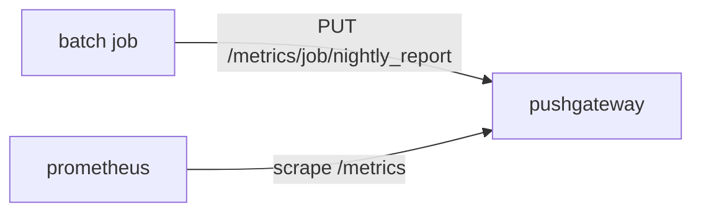

# Push Delivery And The Pushgateway

Pull collection assumes that the target is alive when the scrape arrives. A batch job breaks that assumption: it starts, does its work in a few seconds and exits, often between two scrapes. Its result is lost unless something keeps it. This part explains what push delivery changes and how the Prometheus Pushgateway handles the one case it was built for.

## Push Delivery Moves The Initiative To The Producer

In a push model, the producer starts the delivery. The producer sends its values to a receiver at moments that it chooses, for example when a job finishes. The receiver stores them or passes them on. The producer needs the address of the receiver, needs network access to it and must decide what to do when the receiver does not answer.

This changes the evidence you get. With pull, a silent target produces `up` with the value 0, and the problem shows at once. With push, a silent producer produces nothing. The receiver cannot tell whether the producer stopped, lost its network, runs on a different schedule or simply had no work to report. Freshness must be stored as data, and the reader must interpret it on purpose.

## The Pushgateway Keeps Results For Scraping

The Prometheus Pushgateway is a separate server. A job sends its metrics to it with an HTTP request. The Pushgateway keeps the latest pushed values in memory and serves them on its own `/metrics` path in the same text format as any target. The Prometheus server then scrapes the Pushgateway like any other target. The Pushgateway is therefore not a replacement for scraping: it is a target that holds the results of jobs which are gone.



The diagram shows two separate paths: the job pushes to the gateway once, and Prometheus scrapes the gateway on its own schedule.

The Pushgateway is meant for service-level batch jobs, that is, jobs whose result belongs to a service and not to one machine. Examples are a nightly report, a database cleanup or a backup. It is not an aggregator, a distributed counter or an event store. For metrics that belong to one machine, such as the result of a job that runs on each host, the textfile collector of the node exporter fits better, because the file stays next to the machine it describes.

## The Push API And The Grouping Key

The push path is `/metrics/job/<job name>`, optionally followed by pairs of a label name and a label value. The `job` label and the extra pairs form the grouping key. A group is the set of metrics that share one grouping key. The path `/metrics/job/nightly_report` creates one group whose only grouping label is `job="nightly_report"`.

Three HTTP methods work on a group. A PUT request replaces all metrics of the group with the metrics in the body. A POST request replaces only the metrics whose names appear in the body and keeps the others. A DELETE request removes every metric of the group. The Pushgateway answers a DELETE with status 202 because it queues the deletion. The body of a push uses the same text format as an exposition endpoint and must end with a newline. The Pushgateway rejects a push that contains explicit timestamps.

Select the playground cluster and define a helper that sends one request to the Pushgateway from the `shuttle` pod.

<!-- astrona:playground:renew -->

```sh
export KUBECONFIG="$(astrona kubeconfig ats-047-playground-040-01)"
test "$(kubectl config current-context)" = "kind-astro-ats-047-playground-040-01" || exit 1
gateway() {
  kubectl -n starfleet exec shuttle -- python -c 'import sys,urllib.request; r=urllib.request.Request("http://pushgateway:9091"+sys.argv[1], data=(sys.argv[3].encode() if len(sys.argv)>3 else None), method=sys.argv[2]); print(urllib.request.urlopen(r,timeout=8).status)' "$@"
}
```

Push one group for a job named `report_demo` with two metrics.

```sh
gateway /metrics/job/report_demo PUT $'demo_records_processed 7\ndemo_last_success_timestamp_seconds 1700000000\n'
```

The command prints the status of the response. A status of 200 means the Pushgateway accepted the group.

## Replace One Metric Or The Whole Group

The difference between PUT and POST decides what a partial push does to the rest of the group. Send a POST that carries only one of the two metrics, with a new value.

```sh
gateway /metrics/job/report_demo POST $'demo_records_processed 9\n'
```

The group still holds `demo_last_success_timestamp_seconds`, because a POST replaces only the metric names that it contains. Now send the same body with PUT.

```sh
gateway /metrics/job/report_demo PUT $'demo_records_processed 9\n'
```

This time the group holds only `demo_records_processed`. The timestamp metric is gone, because a PUT replaces everything in the group. The next section reads the page of the gateway, which shows the final state of the group. A job that reports several metrics should push them all in one request, so that the group always holds one consistent result.

## What The Gateway Adds And What Prometheus Sees

Read the page that Prometheus scrapes. The Pushgateway serves your two metrics, and it adds metrics of its own for every group. The metric `push_time_seconds` holds the Unix time of the last successful push, and `push_failure_time_seconds` holds the time of the last failed push. A value of 0 means that no such push happened.

```sh
kubectl -n starfleet exec shuttle -- python -c 'import urllib.request; print(urllib.request.urlopen("http://pushgateway:9091/metrics",timeout=8).read().decode())' | grep -E 'demo_|push_time|push_failure'
```

You see each metric with the label `job="report_demo"`, and the Pushgateway also exposes an empty `instance` label. After a few scrapes the Prometheus server holds the same series. The metric values do not change between scrapes, because the gateway repeats the last pushed value each time. Query `demo_records_processed` and `push_time_seconds` to see them in Prometheus.

## The Gateway Does Not Know The Job Is Still Running

Look at what the repeated value means. The Prometheus server stores a new sample of `demo_records_processed` every two seconds, each with the same value, even though the job ran only once. Nothing in these samples says when the job ran. A dashboard that only draws the metric looks healthy forever.

That is why `push_time_seconds` and a metric that you push yourself, such as a last success timestamp, are important. They turn freshness into a value that a query can test, for example `time() - demo_last_success_timestamp_seconds`. The Pushgateway sets the first. Only the job knows whether the work succeeded, so the job must push the second one, and only after success.

You now know how a result reaches Prometheus when the job is gone, and why the gateway cannot show that the job is alive. The next question is what happens to a group over time and how the labels of a group survive the scrape.

## Common pitfalls

> [!WARNING]
> A push with PUT replaces the whole group, so a job that pushes only one metric with PUT removes its other metrics. A push without a trailing newline in the body is rejected. A successful scrape of the Pushgateway does not show that the job ran recently.
