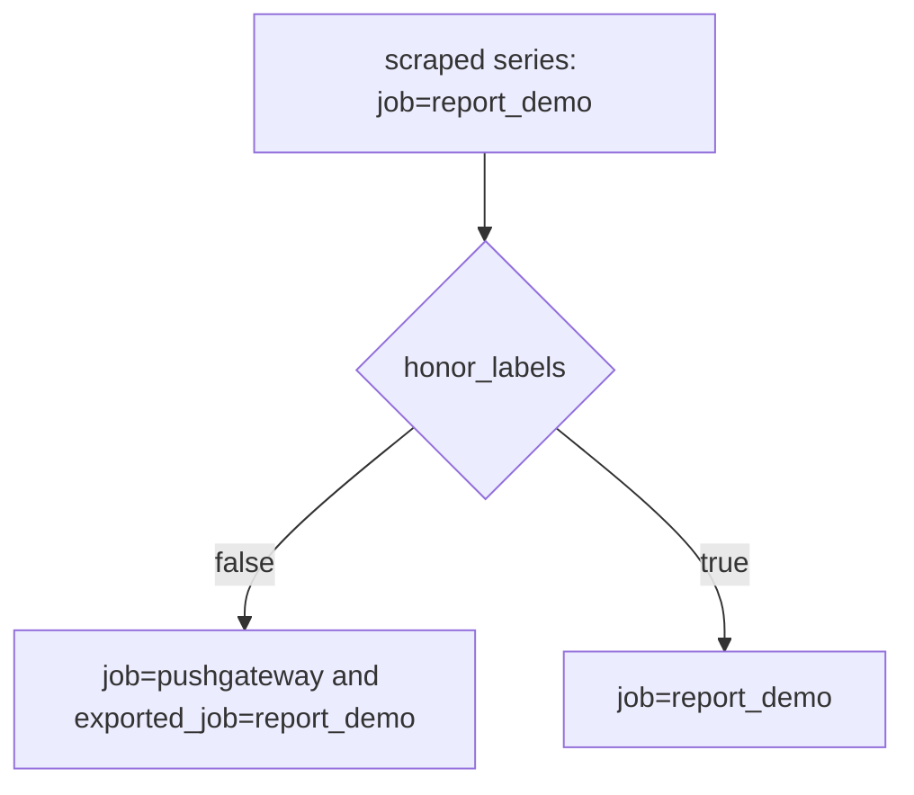

# Pushgateway Lifecycle And Labels

A pushed group does not behave like a scraped target. Nothing starts it and nothing ends it. It stays in the Pushgateway until someone replaces or deletes it, and Prometheus keeps scraping it for as long as it stays. This part explains how the labels of a pushed group reach Prometheus, how a group becomes stale data and which design rules keep a Pushgateway useful.

## Prometheus Has To Decide Which Label Wins

When Prometheus scrapes the Pushgateway, two sources name the job. The scrape job in the configuration is called `pushgateway`, and the pushed series carry the label `job="report_demo"`. Prometheus must decide which value to keep. The setting `honor_labels` makes the decision. When it is `false`, the default, the labels of the scrape win. Prometheus renames each conflicting label from the data with the prefix `exported_` and stores `job="pushgateway"` and `exported_job="report_demo"`. When it is `true`, the labels from the data win, and the series keep `job="report_demo"`.

The Pushgateway documentation says to always set `honor_labels: true` for the scrape job of a Pushgateway. Without it, every pushed series looks like it belongs to the gateway, and a query or an alert that filters on the job of the batch finds nothing.

## See The Renamed Labels

The playground starts with a `pushgateway` scrape job that has no `honor_labels`. Select the cluster and define the helpers.

<!-- astrona:playground:renew -->

```sh
export KUBECONFIG="$(astrona kubeconfig ats-047-playground-040-01)"
test "$(kubectl config current-context)" = "kind-astro-ats-047-playground-040-01" || exit 1
prom_query() {
  kubectl -n starfleet exec shuttle -- python -c 'import sys,urllib.parse,urllib.request; print(urllib.request.urlopen("http://prometheus:9090/api/v1/query?"+urllib.parse.urlencode({"query":sys.argv[1]}),timeout=8).read().decode())' "$1"
}
gateway() {
  kubectl -n starfleet exec shuttle -- python -c 'import sys,urllib.request; r=urllib.request.Request("http://pushgateway:9091"+sys.argv[1], data=(sys.argv[3].encode() if len(sys.argv)>3 else None), method=sys.argv[2]); print(urllib.request.urlopen(r,timeout=8).status)' "$@"
}
gateway /metrics/job/report_demo PUT $'demo_records_processed 7\n'
```

Wait about ten seconds for several scrapes, then query the series.

```sh
prom_query 'demo_records_processed'
```

The result carries the label `exported_job="report_demo"` and the label `job="pushgateway"`. Now add `honor_labels: true` under the job `pushgateway` in the ConfigMap `prometheus-config`, apply it and restart the Prometheus Deployment so it reads the file.

```sh
kubectl -n starfleet edit configmap prometheus-config
kubectl -n starfleet rollout restart deployment/prometheus
kubectl -n starfleet rollout status deployment/prometheus --timeout=180s
```

In the editor, put the line `honor_labels: true` at the same indentation as `job_name` in the `pushgateway` entry, then save. After the restart and a few scrapes, `prom_query 'demo_records_processed'` returns the label `job="report_demo"`. The restart empties the storage of the Prometheus server, so the first queries are empty until it scrapes again.



The diagram shows that one setting decides whether the job name of the batch or the job name of the scrape survives. The same rule applies to the `instance` label, and the Pushgateway exposes an empty `instance` label so that Prometheus does not add the address of the gateway.

## A Group Lives Until Someone Removes It

The Pushgateway never expires a group by itself. A group leaves in one of three ways: a DELETE request removes it, a PUT replaces its content, or a restart of the Pushgateway without persistence clears the memory. The option `--persistence.file` writes the data to a file so that it survives a restart. In every other case, the Prometheus server scrapes the same old values at every interval.

The consequences are easy to miss. The metric `up{job="pushgateway"}` stays at 1 as long as the gateway answers, even if the last push was a month ago. A job that was retired still has its group, and the group still looks like current data. Cleanup is therefore a duty of the owner of the job: delete the group when the job is removed, and delete or replace it when the grouping labels change.

## Grouping Labels Decide The Size Of The Problem

Each distinct grouping key creates a group. A job that adds a label with a value from a long list, such as a host name or a process identifier, creates a new group with every run. The old groups never leave, and the number of series grows without limit. This is a cardinality problem: the cost of a Prometheus server grows with the number of distinct series.

Use a stable identity, such as the name of the service and the name of the job, and replace the group at every run. If you must keep several results, give each a fixed set of labels, such as `stage` with values from a short list. Decide who deletes the groups before the first push.

## Make Freshness A Value You Can Alert On

The job should push a metric that holds the Unix time of its last successful finish, such as `demo_last_success_timestamp_seconds`. A rule can then test the age.

```sh
gateway /metrics/job/report_demo PUT "demo_last_success_timestamp_seconds $(date +%s)"$'\n'
prom_query 'time() - demo_last_success_timestamp_seconds{job="report_demo"}'
```

The second command returns the age of the last success in seconds. An alert on `time() - demo_last_success_timestamp_seconds > 86400` fires when a daily job misses a run, whatever the state of the gateway. Clean up the demo group when you finish.

```sh
gateway /metrics/job/report_demo DELETE
```

## When Not To Use The Pushgateway

The Pushgateway is a single point of failure for every job that pushes to it. It makes `up` meaningless for the producers, because `up` describes only the gateway. If a long-running service can be scraped, scrape it. Use the gateway for service-level batch results, and keep machine-level batch results in the textfile collector.

You now know how a pushed result keeps its identity, why it can outlive its producer and how to make its age visible. A Pushgateway is one way to move data. The next topic is a different transport, which sends samples that Prometheus already collected.

## Common pitfalls

> [!WARNING]
> Without `honor_labels: true`, a query on the job name of the batch returns nothing, because the label is renamed to `exported_job`. Editing the ConfigMap does not change the running server until it reloads or restarts. A retired job leaves its group behind until you delete it.
