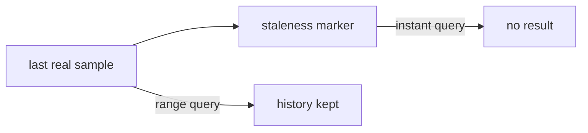

# Staleness And The Lookback Window

An instant query asks for the value of a series at one moment, but a series only has samples at scrape times. Prometheus needs a rule for the moments in between, and a rule for the moment when a series ends. These rules are the lookback window and staleness. They decide when a pushed or scraped series disappears from a query result, so they matter whenever you read freshness from data.

## An Instant Query Looks Back

When you evaluate a selector at a time `t`, Prometheus does not require a sample at exactly `t`. It takes the newest sample at or before `t`, but only if that sample is not older than the lookback delta. The default lookback delta is five minutes. It is set with the flag `--query.lookback-delta`. A series whose newest sample is older than that returns no value.

The rule has a reason. Different series are scraped at different moments, and queries must combine them. The window lets a query line up series that do not share timestamps. The price is that, without any other rule, a series that stopped would still appear for up to five minutes after its last sample.

A short example shows the rule. A gauge was scraped at 10:00:00 with the value 5, and the target then stopped answering without any marker. A query at 10:03:00 returns 5, because the sample is three minutes old and inside the window. A query at 10:06:00 returns nothing, because the sample is six minutes old. In practice a marker usually appears at the first failed scrape, so the series ends sooner than the window.

## Staleness Markers End A Series Early

Prometheus ends a series earlier with a staleness marker. A staleness marker is a special sample value that tells the query engine that the series has ended. Prometheus writes markers in two situations. First, when a scrape no longer contains a series that the previous scrape contained, it marks that series stale. Second, when a target disappears, because the scrape failed or because the target left the configuration, it marks all series of that target stale.

After a marker, an instant query returns nothing for that series. The marker is not shown as a number. Range queries ignore it: a selector with a range, such as `x[10m]`, returns only the real samples, so the history before the marker stays available to functions such as `count_over_time()`.



The diagram shows that the marker ends the series for instant queries and leaves the stored samples for range queries.

## Staleness In The Pushgateway Path

The Pushgateway serves its metrics without timestamps. Prometheus therefore stamps them with the time of each scrape, and the staleness rules apply. While the group exists, every scrape contains the series, and the series stays current. When you delete the group, the next scrape no longer contains it, and Prometheus writes markers.

Select the playground cluster and define the helpers.

<!-- astrona:playground:renew -->

```sh
export KUBECONFIG="$(astrona kubeconfig ats-047-playground-040-02)"
test "$(kubectl config current-context)" = "kind-astro-ats-047-playground-040-02" || exit 1
prom() {
  kubectl -n starfleet exec shuttle -- python -c 'import sys,urllib.parse,urllib.request; print(urllib.request.urlopen("http://prometheus:9090/api/v1/query?"+urllib.parse.urlencode({"query":sys.argv[1]}),timeout=8).read().decode())' "$1"
}
gateway() {
  kubectl -n starfleet exec shuttle -- python -c 'import sys,urllib.request; r=urllib.request.Request("http://pushgateway:9091"+sys.argv[1], data=(sys.argv[3].encode() if len(sys.argv)>3 else None), method=sys.argv[2]); print(urllib.request.urlopen(r,timeout=8).status)' "$@"
}
gateway /metrics/job/stale_demo PUT $'demo_value 1\n'
```

Wait about ten seconds, then query the series and delete the group.

```sh
prom 'demo_value{job="stale_demo"}'
gateway /metrics/job/stale_demo DELETE
```

The first query returns one series. The Pushgateway answers the DELETE with status 202. Wait ten seconds so that one or more scrapes pass without the series.

```sh
prom 'demo_value{job="stale_demo"}'
prom 'count_over_time(demo_value{job="stale_demo"}[10m])'
```

The first query returns an empty result, although the last real sample is only seconds old. The second returns one series with the number of real samples stored before the delete. The staleness marker removed the series from the instant query without removing its history.

## Failed Scrapes And Missing Targets

The same rule covers `up` and the failure of a whole target. When a scrape fails, Prometheus stores `up` with the value 0 and marks the series of the previous scrape stale, so the application metrics disappear from instant queries at once. A dashboard that shows the last value of a metric therefore goes blank when the target fails, and the series `up` is the way to see why.

Query time also matters when you compare servers. Two servers that evaluate the same expression at different times can disagree for one scrape interval, and a remote receiver adds the delay of the queue.

## Test Freshness By Value Instead Of Presence

Presence is a weak test. The expression `absent(x)` fires only after the series is gone, and a series with a recent marker is gone at once, while a series without a marker stays for up to five minutes. A stronger test uses the sample value. For a metric that holds the Unix time of the last success, the expression `time() - x > 3600` finds a result that is older than one hour, whatever the lookback window does. For a counter, `increase(x[1h]) == 0` finds a producer that has done no work in one hour.

The window also affects rate functions over a range. A range selector must hold at least two samples, so the range must be several times larger than the scrape interval. A range of ten minutes holds the samples of a job that was scraped for ten minutes and then deleted, and `count_over_time()` shows them.

Recording and alerting rules follow the same rule. A rule that no longer returns a series marks the series it wrote earlier as stale, so an alert that stops matching resolves instead of lingering.

## When Staleness Does Not Apply

Some targets expose their own timestamps in the text. With the default settings, Prometheus then keeps the series current only by the lookback window, so a series that stops being exported lingers for up to five minutes before it disappears. A series that a rule or a remote system produces has its own handling, and a system that receives samples by remote write applies its own lookback rules.

You now know when a series ends and what a query returns after it. The last part combines these rules with the transport stages into one method for judging whether data is fresh.

## Common pitfalls

> [!WARNING]
> An empty instant result does not mean that no data was ever stored, because the range history stays. A series from a target with its own timestamps stays visible for the lookback window after it stops. An alert that tests only the presence of a series misses a series that is still inside the five-minute window.
