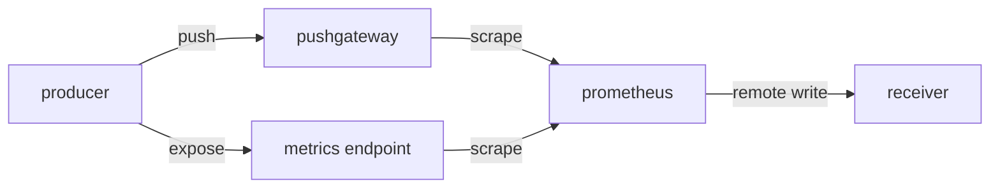

# Tracing Freshness Through The Collection Path

A metric that looks wrong or old has several possible causes, and each one sits in a different component. A good operator does not guess. The operator follows the data from the producer to the reader and checks each stage with evidence. This part defines the stages for the transports covered so far and shows how to use the evidence at each one.

## The Stages

For a scraped service, the path has four stages. The producer exposes the current values on its metrics endpoint. The scrape reads them and stores samples on the Prometheus server. Local processing, such as relabeling, recording rules and alerting rules, changes or derives series. Downstream delivery, which is remote write, copies samples to another system. For a pushed batch job, a fifth stage sits at the start: the job pushes to the Pushgateway, and the Prometheus server scrapes the gateway.



The diagram shows that the Prometheus server is the meeting point of both transports and that remote write starts only after the data is stored locally.

A stage can also hide a fault from the next one. Relabeling can drop a series before storage, and then neither the local server nor the receiver ever holds it, although the producer exposes it. The targets page and the metrics endpoint then disagree with a query, which points at local processing.

## The Evidence At Each Stage

Each stage leaves its own evidence.

- Producer: the metrics endpoint shows the current values. For a batch job, the pushed timestamp metric and `push_time_seconds` show the last run.
- Scrape: `up`, `scrape_duration_seconds` and the targets endpoint show whether the last scrape worked and how long it took.
- Local processing: the rules page of the server and the series that rules produce show whether a derived series is current.
- Downstream: the series `prometheus_remote_storage_samples_pending` and the failure counters show whether the queue keeps up, and a query on the receiver shows what arrived.

The order of the stages also tells you how long a fault takes to show. A failed scrape shows in the `up` series at the next scrape, which is two seconds in the playground. A job that stops pushing shows only when its age metric crosses the threshold of the alert, which can be hours for a daily job. A remote write fault shows when the queue fills or when a reader compares the two servers. Each alert should therefore watch the stage where its fault appears first.

A fault at a stage affects only the stages after it. A failed scrape makes the local series stale, and the receiver then holds the same gap. A failed receiver leaves local data untouched. Therefore, check the stages in order and stop at the first one that is wrong.

## A Worked Case

The receiver shows no recent value for `demo_last_success_timestamp_seconds`, and an alert on its age fires. Begin on the Prometheus server, because the data enters downstream storage only from there. Select the playground cluster and define a helper.

<!-- astrona:playground:renew -->

```sh
export KUBECONFIG="$(astrona kubeconfig ats-047-playground-040-02)"
test "$(kubectl config current-context)" = "kind-astro-ats-047-playground-040-02" || exit 1
query() {
  kubectl -n starfleet exec shuttle -- python -c 'import sys,urllib.parse,urllib.request; print(urllib.request.urlopen(sys.argv[1]+"/api/v1/query?"+urllib.parse.urlencode({"query":sys.argv[2]}),timeout=8).read().decode())' "$1" "$2"
}
```

First, confirm that the gateway scrape works. Then compare the local value with the downstream value. The commands below need a `remote_write` entry for `http://receiver:9090/api/v1/write` in the ConfigMap `prometheus-config`. If it is missing, add it and restart the `prometheus` Deployment first.

```sh
query http://prometheus:9090 'up{job="pushgateway"}'
query http://prometheus:9090 'push_time_seconds'
query http://receiver:9090 'push_time_seconds'
```

Interpret the three answers together. If `up` is 0, the fault is in the scrape stage and the gateway is unreachable or unreadable. If `up` is 1 and the local `push_time_seconds` is old, the scrape works but the job has not pushed, so the fault is at the producer. If the local value is recent and the receiver shows an old value or nothing, the fault is downstream: check the pending and failed counters.

## Break The Last Stage On Purpose

An outage of the receiver shows that stages fail independently. Scale the `receiver` Deployment to zero replicas. The first server keeps scraping, so its local queries stay current, while its remote write queue cannot deliver.

```sh
kubectl -n starfleet scale deployment/receiver --replicas=0
```

Wait about thirty seconds. Query `up{job="probe"}` on the first server, and then query `sum(prometheus_remote_storage_samples_failed_total)` and `sum(prometheus_remote_storage_samples_pending)` on it. The first query still returns the value 1, because collection works. The queue counters show that the delivery stage has a problem: the failed count rises or the pending count grows, depending on how the sender retries. Scale the receiver back to one replica when you finish.

```sh
kubectl -n starfleet scale deployment/receiver --replicas=1
kubectl -n starfleet rollout status deployment/receiver --timeout=180s
```

The new receiver pod starts with empty storage, so it holds only the samples that arrive after the restart. The samples written during the outage stay in the write-ahead log of the first server and are sent when the receiver is back, as long as the outage is shorter than the retention of the log.

## Choose The Transport By What You Must Know

The choice of transport follows the question you need to answer. A long-running service that listens on a port gives the best evidence with pull, because `up` and the scrape duration cost nothing. A short service-level batch job can use the Pushgateway when its group cleanup and freshness metric are defined. Copying data to another system is a job for remote write, which never replaces collection. Convenience alone is not a reason, because a choice that makes a stale value look like a success hides the failure that you wanted to see.

You now have a method that works for every path in this module: name the stages, read the evidence at each one in order and stop at the first fault. The summary ties the ideas together.

## Common pitfalls

> [!WARNING]
> Checking the receiver first hides the real fault, because every earlier stage can break the data that arrives there. A recent `push_time_seconds` proves that a push happened, not that the work succeeded. Do not treat a healthy `up` for the Pushgateway as proof that the producer runs.
