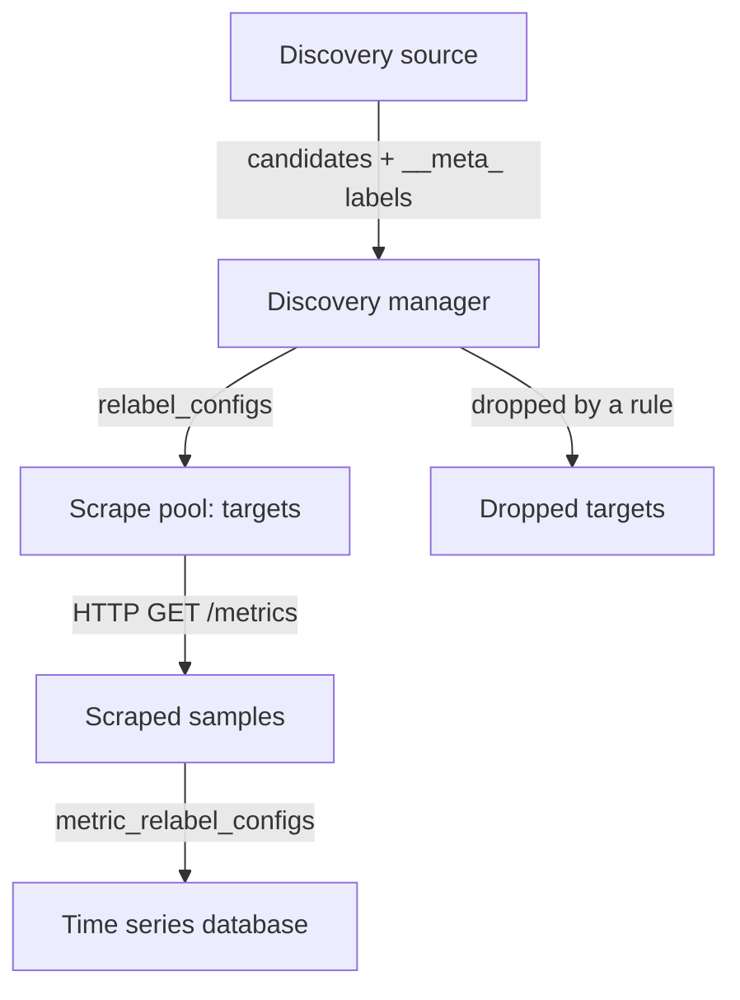

# Static And Dynamic Service Discovery

Prometheus does not receive metrics. It pulls them: on a fixed interval it sends an HTTP request to each endpoint it knows about and reads the text in the response. The first problem to solve is therefore simple to state and hard to keep solved: how does Prometheus learn which endpoints exist? This page shows the two answers, a list you write by hand and a list that a discovery mechanism produces, and it follows the data from discovery to a stored `up` series.

## Targets And Scrape Jobs

A target is one endpoint that Prometheus scrapes: an address and port, a URL path (by default `/metrics`) and a scheme (`http` or `https`). A scrape job groups targets that are scraped in the same way. Each job is one entry under `scrape_configs` in the Prometheus configuration file, and each job has a `job_name`. Prometheus adds that name to every sample of the job as the `job` label.

The simplest way to fill a job is `static_configs`. You write the addresses yourself:

```yaml
scrape_configs:
- job_name: probe
  static_configs:
  - targets:
    - probe:8080
```

This is correct as long as the list never changes. In a Kubernetes cluster it changes all the time. A Deployment replaces its pods during a rollout, a node failure moves pods to other nodes, and a scale-up adds new pods. Every replaced pod gets a new IP address. A hand-written list is wrong a few minutes after you write it, and you must edit the file and reload Prometheus for each change.

## Discovery Mechanisms

Service discovery moves the list out of the configuration file. Instead of addresses, you describe where to ask. Prometheus contacts that source, receives the current list of candidates, and updates its targets whenever the source changes. The server has a built-in discovery component that runs one discoverer per configured source.

Prometheus supports many sources. These are the ones you meet most often:

- `static_configs`: addresses written in the configuration file.
- `file_sd_configs`: JSON or YAML files that another program writes. Prometheus watches the files and reads them again when they change.
- `dns_sd_configs`: DNS records (`A`, `AAAA` or `SRV`) that Prometheus resolves on a refresh interval.
- `kubernetes_sd_configs`: the Kubernetes API server. Prometheus watches pods, Services, endpoints, nodes or ingresses.
- `consul_sd_configs`, `ec2_sd_configs`, `azure_sd_configs`, `gce_sd_configs` and others: the API of a service registry or cloud provider.

Every mechanism returns the same shape of data. Each candidate has an address in the internal label `__address__`, and it has extra metadata in internal labels that start with `__meta_` and name the mechanism, for example `__meta_kubernetes_pod_name` or `__meta_consul_service`. The metadata is what makes later selection possible, because the address alone says nothing about which application owns the endpoint.

## From Candidate To Stored Series

Discovery only produces candidates. Between a candidate and a stored sample there are several steps, and each one can remove or change data.



The diagram shows that a candidate can leave the flow before any request is sent. The discovery manager inside the Prometheus server receives candidates from each source. Target relabeling (`relabel_configs`) then decides which candidates become targets and what labels they carry. The scrape pool sends the HTTP requests. Metric relabeling (`metric_relabel_configs`) can still change or drop samples before they reach the time series database.

The word "target" is used for two different states. A discovered candidate that a rule removed is a dropped target. A candidate that passed every rule is an active target, and only active targets are scraped. For each active target Prometheus writes a synthetic series named `up` with the value 1 when the scrape succeeded and 0 when it failed. A dropped target has no `up` series at all. This difference matters when you search for a missing service: no `up` series means "never selected", while `up` equal to 0 means "selected but not reachable".

## Try It: Static Targets Hide Replicas

Start the playground and open a shell on your machine. The next commands select the cluster of this playground, check the context so that nothing else is changed, and define two helper functions. `prom_get` runs an HTTP request against the Prometheus API from the `shuttle` pod, because the Prometheus Service is only reachable inside the cluster. `show_targets` prints the job, the scrape URL and the health of each active target.

<!-- astrona:playground:renew -->

```sh
export KUBECONFIG="$(astrona kubeconfig ats-047-playground-050-01)"
test "$(kubectl config current-context)" = "kind-astro-ats-047-playground-050-01" || exit 1
prom_get() {
  kubectl -n starfleet exec shuttle -- python -c 'import sys, urllib.request; print(urllib.request.urlopen("http://prometheus:9090" + sys.argv[1], timeout=8).read().decode())' "$1"
}
show_targets() {
  prom_get '/api/v1/targets' | python3 -c 'import json, sys
for target in json.load(sys.stdin)["data"]["activeTargets"]:
    print(target["labels"].get("job"), target["scrapeUrl"], target["health"])'
}
```

The playground Prometheus starts with only static jobs. Read its configuration and list the targets it scrapes:

```sh
kubectl -n starfleet get configmap prometheus-config -o jsonpath='{.data.prometheus\.yaml}'
show_targets
```

You should see one target for the `prometheus` job and one target for the `probe` job. The `probe` target is the name `probe:8080`, which is the Kubernetes Service in front of the `probe` pods. The Deployment runs two `probe` pods, so check that:

```sh
kubectl -n starfleet get pods -l app=probe -o wide
```

Now scale the Deployment to three pods and list the targets again after a short wait:

```sh
kubectl -n starfleet scale deployment/probe --replicas=3
kubectl -n starfleet rollout status deployment/probe
show_targets
```

The list of targets is the same as before. Prometheus resolves `probe:8080` to the Service address, and the Service sends each scrape to one of the pods. Prometheus never sees the individual pods. It cannot tell you which pod produced a sample, and a pod that fails while the others stay healthy can stay hidden for a long time. Restore the replica count before you go on:

```sh
kubectl -n starfleet scale deployment/probe --replicas=2
```

## What You Know Now

A target is an address, a path and a scheme. A static list is simple but cannot follow a cluster that changes, and when it points at a Service it hides the individual pods. Service discovery asks a source for the current candidates, and every candidate carries an address plus `__meta_` metadata. Candidates then go through target relabeling, and only the ones that pass become active targets with an `up` series. The open question is how to ask Kubernetes for the pods themselves, which is the next topic.

## Common pitfalls

> [!WARNING]
> A missing `up` series and an `up` series equal to 0 are different problems: the first means the candidate was dropped or never discovered, the second means Prometheus tried to scrape it and failed. A static target that names a Service shows one target for all replicas, so a single unhealthy pod is not visible as its own series.
