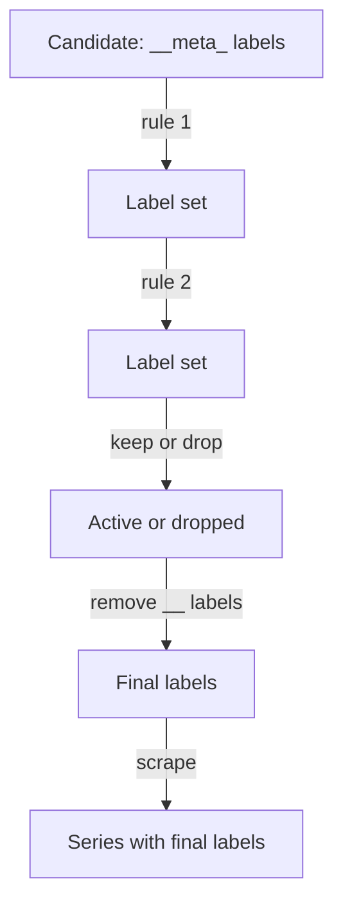

# How Target Relabeling Works

A discovered pod arrives with a pod IP address and dozens of `__meta_kubernetes_*` labels. If Prometheus stored all of that, every series would carry labels nobody queries, and it would still lack the label you want, such as the namespace or the application name. Target relabeling is the step that fixes this. It runs a list of rules over each candidate before the first scrape, and the result is the final label set of the target. This page explains how a rule is evaluated, and it shows the difference between what discovery found and what Prometheus kept.

## Rules, Fields And Defaults

Relabeling rules sit under `relabel_configs` in a scrape job. Prometheus evaluates the rules for each candidate, in the order they are written, and each rule sees the result of the rules before it. A rule has these fields:

- `source_labels`: a list of label names to read.
- `separator`: the text that joins the values of the source labels into one string. The default is `;`.
- `regex`: the regular expression the joined string is matched against. The default is `(.*)`.
- `action`: what to do. The default is `replace`.
- `target_label`: the label to write, for the actions that write a label.
- `replacement`: the text to write. The default is `$1`, the first capture group of the regular expression.

The regular expression is anchored at both ends. The value `probe` matches the string `probe` only, and it does not match `probe-v2`. To match more, write the pattern out: `probe.*` or `probe|scout`.

The `replace` action joins the source label values, matches the result against the regular expression, and if it matches, writes the replacement into `target_label`. Capture groups are available as `$1`, `$2` and so on. If the expression does not match, the rule does nothing and the label set stays as it was. This silent behavior is the main reason that relabeling mistakes are hard to see.

## Which Labels Survive

Before the first rule runs, a candidate has its internal labels, the `job` label from the job name, and `__address__`. After the last rule runs, Prometheus applies three finishing steps:

- Prometheus removes every label whose name starts with two underscores. The `__meta_*` labels, `__address__` and `__metrics_path__` disappear from the final label set.
- If the target has no `instance` label, Prometheus sets it to the value of `__address__`.
- Prometheus attaches the final labels to every sample that it scrapes from the target.

This is why a pod name does not show up in your queries by default. The data existed during relabeling, and a rule has to copy it to a label without the underscore prefix to keep it. A few internal labels also have a job beyond metadata: `__address__` is where Prometheus connects, `__scheme__` is `http` or `https`, `__metrics_path__` is the URL path, and each `__param_<name>` label becomes a URL query parameter. Rules can change them, and the scrape uses the changed values.



The diagram shows that rules run in sequence and that the double-underscore labels are removed only at the end, so every rule can still read them.

## Try It: Compare Discovered And Final Labels

Open a shell and select the cluster. The helper `show_labels` prints, for each active target of the job `pods`, the discovered labels that Prometheus received and the final labels that remain after relabeling, as JSON on one line each.

<!-- astrona:playground:renew -->

```sh
export KUBECONFIG="$(astrona kubeconfig ats-047-playground-050-02)"
test "$(kubectl config current-context)" = "kind-astro-ats-047-playground-050-02" || exit 1
prom_get() {
  kubectl -n starfleet exec shuttle -- python -c 'import sys, urllib.request; print(urllib.request.urlopen("http://prometheus:9090" + sys.argv[1], timeout=8).read().decode())' "$1"
}
show_labels() {
  prom_get '/api/v1/targets' | python3 -c 'import json, sys
for target in json.load(sys.stdin)["data"]["activeTargets"]:
    if target["labels"]["job"] == "pods":
        print("FINAL", json.dumps(target["labels"], sort_keys=True))'
}
show_labels
```

The playground job discovers every pod and has no rules. The final labels hold only `instance` and `job`. The pod name, the namespace and the application are gone, even though discovery had them. Add two rules that copy the namespace and the pod name. Save this as `prometheus-config.yaml`:

```yaml
apiVersion: v1
kind: ConfigMap
metadata:
  name: prometheus-config
  namespace: starfleet
data:
  prometheus.yaml: |
    global:
      scrape_interval: 5s
      evaluation_interval: 5s
    scrape_configs:
    - job_name: prometheus
      static_configs:
      - targets:
        - localhost:9090
    - job_name: pods
      kubernetes_sd_configs:
      - role: pod
        namespaces:
          names:
          - starfleet
          - outpost
      relabel_configs:
      - source_labels: [__meta_kubernetes_namespace]
        target_label: namespace
      - source_labels: [__meta_kubernetes_pod_name]
        target_label: pod
```

Apply it:

```sh
kubectl apply -f prometheus-config.yaml
```

Then restart Prometheus and print the labels again:

```sh
kubectl -n starfleet rollout restart deployment/prometheus
kubectl -n starfleet rollout status deployment/prometheus
show_labels
```

Each rule uses the default action `replace`, the default regular expression `(.*)` and the default replacement `$1`. It copies the whole value of one internal label into a public label. Every target now has `namespace` and `pod` next to `instance` and `job`. The internal labels are still not in the final set. To see them, read the `discoveredLabels` field of the same API response, which keeps the values from before relabeling.

## What You Know Now

A rule reads source labels, joins them with a separator, matches them against an anchored regular expression and, for `replace`, writes the replacement into a target label. Rules run in order, and only labels without the double-underscore prefix survive. A copy rule is how metadata becomes a queryable label. The open question is how to remove targets, since so far every candidate stayed.

## Common pitfalls

> [!WARNING]
> A `replace` rule whose regular expression does not match does nothing and gives no error, so a mistake in a pattern shows up only as a missing label. The pattern is anchored: `probe` does not match `probe-v2`. Internal labels are removed after the last rule, so copy any metadata you want to query into a public label.
