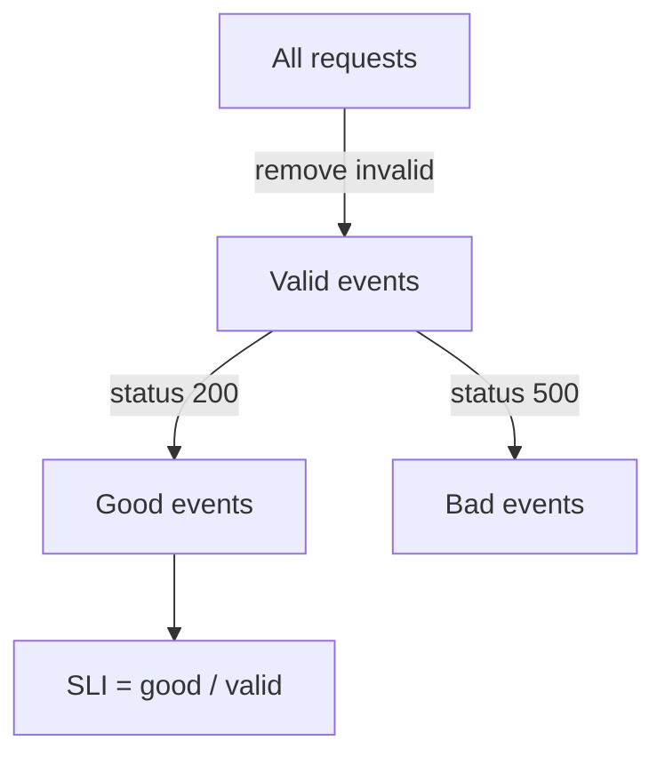

# Service Level Indicators

A team that runs a service needs one honest answer to the question "is the service good for its users right now?". Logs, dashboards and a feeling of calm do not give that answer in a form that two people read the same way. A Service Level Indicator (SLI) is the measurement that does. This part explains what an SLI is made of, how to build one from Prometheus metrics, and where the measurement is taken.

## What An SLI Is

A Service Level Indicator (SLI) is a number that says how well a service did its job over a period. Almost every useful SLI is a ratio: the number of good events divided by the number of valid events. The result is between 0 and 1, and it is often written as a percentage.

An event is one unit of work the service performs for a user. For an HTTP service an event is usually one request. For a batch pipeline an event can be one record, and for a storage system it can be one read. The service decides what an event is, and the SLI definition must say it in words before any query is written.

## Valid And Good Events

The ratio has two parts, and each part needs a rule. The valid events are the events that count. The good events are the valid events that the service handled correctly. Every good event is also a valid event, so the ratio never goes above 1.

Take the `probe` Service in the `starfleet` namespace. It answers each request with status 200 or status 500. A rule for an availability SLI can read: valid events are all requests the probe finished, and good events are the requests that returned status 200. The SLI is then the number of status 200 responses divided by the number of all responses.



The diagram shows that the invalid events leave before the ratio is calculated, and that every valid event is either good or bad. The rule for invalid events needs care. A request that fails because the client sent a malformed body is not the service's fault, so many teams leave it out of the valid events. A request that fails because the service was too slow, or because the client gave up waiting, is a failure the user felt, so it stays in. Removing failures only to improve the number defeats the purpose of the SLI.

## An Availability SLI In Prometheus

Prometheus is a monitoring system that scrapes metrics over HTTP and stores them as time series. A counter is a metric that only goes up while a process runs, and it is the usual source for event counts. The `probe` exposes the counter `lab_requests_total`, with one series for each value of the label `status`.

The `rate` function turns a counter into a per-second rate over a range such as `[20s]`. Dividing the rate of status 500 by the rate of all requests gives the share of bad events. The share of good events is one minus that value, or the same division with `status="200"` in the numerator.

The commands below connect to the playground and define a helper that sends a PromQL (Prometheus Query Language) query to the Prometheus API from inside the cluster. The `shuttle` pod runs the request because the Prometheus Service is only reachable inside the cluster.

<!-- astrona:playground:renew -->

```sh
export KUBECONFIG="$(astrona kubeconfig ats-047-playground-060-01)"
test "$(kubectl config current-context)" = "kind-astro-ats-047-playground-060-01" || exit 1
query_prometheus() {
  kubectl -n starfleet exec shuttle -- python -c "import sys,urllib.parse,urllib.request; print(urllib.request.urlopen('http://prometheus:9090/api/v1/query?'+urllib.parse.urlencode({'query':sys.argv[1]}),timeout=8).read().decode())" "$1"
}
```

Now ask for the availability SLI. The query keeps only the series with `status="200"` in the numerator and sums over all series, so the result is one number.

```sh
query_prometheus 'sum(rate(lab_requests_total{status="200"}[20s])) / sum(rate(lab_requests_total[20s]))'
```

The response is a JSON document. The field `data.result[0].value` holds the evaluation time and the ratio as a string. The traffic generator makes one request in ten fail, so the ratio is close to 0.9. If the result list is empty, Prometheus has fewer than two samples in the range, so wait a few seconds and run the command again.

## A Latency SLI From A Histogram

Speed is part of the user experience, so a second SLI counts requests that finished within a time limit. A histogram metric stores the number of observations at or below fixed limits. The `probe` exposes `lab_request_duration_seconds_bucket` with the label `le` (less than or equal), and the buckets have the limits 0.01, 0.05, 0.1 and `+Inf` seconds. Each bucket counts all requests with a duration at or below its limit, so the buckets are cumulative.

The good events of a latency SLI are the requests in one bucket, and the valid events are all requests, which the `_count` series gives. A threshold of 50 milliseconds uses the bucket `le="0.05"`. The threshold must match a bucket limit. If the histogram has no bucket at 0.07, the query cannot answer for 70 milliseconds without guessing.

```sh
query_prometheus 'sum(rate(lab_request_duration_seconds_bucket{le="0.05"}[20s])) / sum(rate(lab_request_duration_seconds_count[20s]))'
```

The result is the share of requests that finished within 50 milliseconds. Notice that this query counts failed requests too, because the probe records a duration for every request. A team that wants "fast and successful" has to build the good events from the status label and the duration together, which needs a metric that carries both labels.

## One Service, Several Indicators

One ratio does not describe a whole service. Availability, latency and correctness are different properties, and a service can pass one and fail another. A common set for a request-driven service is one availability SLI and one latency SLI. A data pipeline often adds a freshness SLI, which is the share of time or records where the data is newer than a limit.

A small worked example shows the arithmetic. In one hour the probe finishes 14,400 requests, and 1,440 of them return status 500. The valid events are 14,400, the good events are 12,960, and the availability SLI is 12,960 divided by 14,400, which is 0.9 or 90 percent. The same hour can have a latency SLI of 99 percent, because the failed requests were still fast. Reading only one of the two numbers would give a wrong picture.

## Where The Measurement Is Taken

The same service has several places where an SLI can be measured, and each place sees a different truth. A metric inside the application sees requests that reached the code. A metric at the load balancer also sees requests that the application never received. A probe that runs from outside the network, called a synthetic check, sees what a user on the internet sees but only for the paths it requests.

A response that the server counts as a success can still fail for the user, for example when the response is lost on the network or arrives after the client's deadline. The closer to the user the measurement is, the more of the real experience it covers, and the more noise from outside the team's control it contains. Choose the place that matches the promise, and write it down.

The metric `up` is a different kind of indicator. It says whether Prometheus could scrape a target. It describes the collection path, not the service. A target can answer every scrape while it fails every user request, and a target can be unreachable for the scraper while users are served normally.

## What You Know Now

An SLI is a ratio of good events to valid events, and its definition has to state what an event is, which events are valid and which are good. You can build an availability SLI from a request counter and a latency SLI from histogram buckets, and you know that the place of measurement changes what the number means. The open question is how good the ratio has to be and over how long a period, and that is what a Service Level Objective answers.

## Common pitfalls

> [!WARNING]
> A latency threshold that is not a histogram bucket limit gives a wrong answer without an error. A ratio over a range that holds fewer than two samples returns no data, which is different from a ratio of zero. The `up` metric is not an availability SLI for users.
