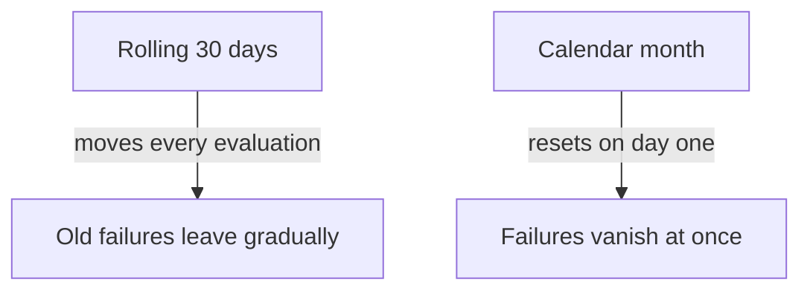

# Service Level Objectives

An SLI tells a team how the service behaves, but a number alone does not say whether that behavior is acceptable. A team that sees 0.97 on its dashboard cannot tell if it should react. A Service Level Objective (SLO) fixes the answer in advance: it sets a target for the SLI over a defined period. This part explains the three pieces of an SLO, how a target translates into allowed failure, and how to check an SLO with a query.

## The Three Parts Of An SLO

A Service Level Objective (SLO) is a target value for an SLI over a time window. It has three parts. The SLI says what is measured, the target says how good the value must be, and the window says over which period the value is judged. Remove any one part and the statement means nothing.

An example for the `probe` Service reads: "99 percent of requests return status 200, measured over a rolling 30 days". The SLI is the ratio of status 200 responses to all responses. The target is 0.99. The window is 30 days. A one-hour graph at 98 percent does not break this SLO by itself, because the judgment covers the whole window.

## Choosing A Target

A target is a decision about users and cost, not a technical constant. A higher target costs more engineering effort and leaves less room to ship changes. A target above what users notice gives them nothing and slows the team down. A target below what users need loses them.

The current performance of the service is the first input. If the service has delivered 99.5 percent for a year, a target of 99.9 percent is a goal that needs work, and a target of 99 percent would let quality fall without any signal. The dependencies are a second input. A service cannot be more available than the systems it calls in every request, unless it degrades gracefully when they fail.

A table helps to see what a target allows. The numbers below assume a window of 30 days, which is 43,200 minutes, and a service where all minutes count the same.

| Target | Allowed bad share | Allowed bad time in 30 days |
| ------ | ----------------- | --------------------------- |
| 99 percent | 1 percent | 7.2 hours |
| 99.9 percent | 0.1 percent | 43.2 minutes |
| 99.99 percent | 0.01 percent | 4.32 minutes |

Each extra nine divides the allowed failure by ten. The table converts a ratio into time. That conversion is only valid for a time-based SLI. For a request-based SLI the allowance is a count of requests, and bad requests can come in a short burst or spread over days.

## Rolling And Calendar Windows

The window decides how the SLO forgets. A rolling window always covers the last N days. Each evaluation moves the window forward, so an incident leaves the calculation exactly N days after it happened. A calendar window covers a fixed period such as one month, and the count starts again on the first day.



The diagram shows that a rolling window changes smoothly and a calendar window changes in one step. A rolling window matches how users remember failures and gives steady guidance. A calendar window matches reports and contracts that are written per month. Many teams use a rolling window for operations and report the calendar month for business reviews.

## Checking An SLO With A Query

Prometheus checks a window with the `increase` function, which returns how much a counter grew over a range. Dividing the increase of good requests by the increase of all requests gives the SLI for that range. In production the range would be `[30d]`. The playground has only minutes of data, so the commands below use `[5m]` to show the same shape.

The helper below sends a query to the Prometheus API through the `shuttle` pod. It needs the connection to the playground.

<!-- astrona:playground:renew -->

```sh
export KUBECONFIG="$(astrona kubeconfig ats-047-playground-060-01)"
test "$(kubectl config current-context)" = "kind-astro-ats-047-playground-060-01" || exit 1
query_prometheus() {
  kubectl -n starfleet exec shuttle -- python -c "import sys,urllib.parse,urllib.request; print(urllib.request.urlopen('http://prometheus:9090/api/v1/query?'+urllib.parse.urlencode({'query':sys.argv[1]}),timeout=8).read().decode())" "$1"
}
query_prometheus 'sum(increase(lab_requests_total{status="200"}[5m])) / sum(increase(lab_requests_total[5m]))'
```

The result is the SLI over the last five minutes, close to 0.9 because the traffic generator fails one request in ten. The next query compares the SLI with the target. The `bool` modifier makes the comparison return 1 when it is true and 0 when it is false, instead of dropping the sample.

```sh
query_prometheus '(sum(increase(lab_requests_total{status="200"}[5m])) / sum(increase(lab_requests_total[5m]))) >= bool 0.99'
```

The answer is 0, so the probe misses a 99 percent objective. Prometheus did the comparison, and the `probe` only counted requests. The SLO itself lives in the query and in the team's documentation, not in the application.

## Writing An SLO Statement

A complete SLO statement is short and has no ambiguity. It names the service, the SLI with its good and valid events, the target and the window. A reader should be able to build the query from the sentence alone.

For the `probe` Service one complete statement is: "Over a rolling 28 days, at least 99 percent of requests that the `probe` Service finishes return a status other than 500."
A second statement covers latency: "Over the same window, at least 95 percent of requests finish within 50 milliseconds."

The statements say nothing about how to react. The reaction belongs to a separate policy that the team agrees on, such as slowing releases when too much failure has happened.

## Several Objectives And Their Limits

A service usually has more than one SLO, for example one for availability and one for latency, and each one has its own SLI, target and window. Different user journeys can need different targets. A checkout request and a request for a help page do not need the same promise. One aggregate SLO over all routes can hide a route that fails often but receives little traffic.

An SLO has limits too. It covers the behavior that the SLI measures. It does not promise that no user ever sees an error, and it does not describe features, data quality or security. The statement is only as strong as its definition of valid and good events.

## What You Know Now

An SLO combines an SLI, a target and a window, and the target decides how much failure is allowed. A rolling window forgets gradually and a calendar window forgets at a fixed date. You can check an SLO with a Prometheus query that divides the increase of good events by the increase of valid events and compares the result with the target. The open question is what happens when an objective becomes a promise to a customer, and that is what a Service Level Agreement covers.

## Common pitfalls

> [!WARNING]
> Converting a request-based target into minutes of downtime is only valid when every minute carries the same traffic. A short window in a query does not prove or break an objective that covers 30 days. A comparison without `bool` returns no sample when it is false, which looks like missing data.
