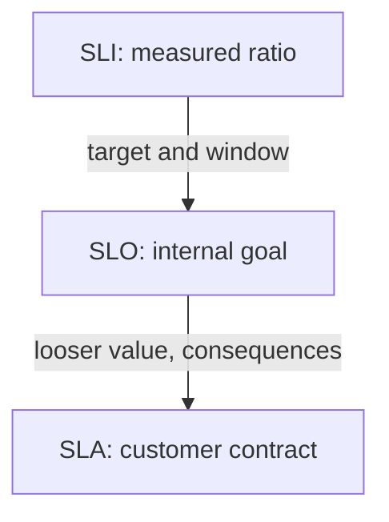

# Service Level Agreements

An SLO is an internal target, and a team can miss it without anyone outside the team noticing. Many services are sold or provided under a contract, and then a missed target has a cost. A Service Level Agreement (SLA) is that contract. This part explains how an SLA differs from an SLO, why the two use different numbers, and how the availability of dependencies limits what a team can promise.

## What An SLA Is

A Service Level Agreement (SLA) is an agreement between a service provider and its customer. It states what the provider promises, how the promise is measured, and what happens when the provider fails to keep it. The consequence is usually a refund or a service credit, which is a reduction of a future bill.

The SLA uses an SLI and a target, as an SLO does. It adds the legal and commercial parts: the measurement period, the exclusions, the way the customer claims a credit, and the size of the credit. Lawyers and business owners write these parts, and engineers supply the measurement that makes them checkable.

## SLI, SLO And SLA Side By Side

The three terms are layered. The SLI is the measurement, the SLO is the internal target for the measurement, and the SLA is the external promise that uses a related measurement.

The diagram shows that the SLO sits between the measurement and the contract. The table lists what differs between them.

| Item | SLI | SLO | SLA |
| ---- | --- | --- | --- |
| What it is | A measured ratio | A target for the ratio | A contract that uses a target |
| Who reads it | Engineers | Engineers and product owners | Customers and the business |
| Missed means | Nothing by itself | The team changes its priorities | The provider pays a consequence |

A service can have an SLO without an SLA, and that is common for internal services. A service should not have an SLA without an SLO behind it, because the team then has no early signal before it owes a credit.

## Why The SLO Is Stricter Than The SLA

A provider promises customers 99.9 percent in the SLA and sets its internal SLO at 99.95 percent. The gap is a margin. When the internal target is missed, the team reacts while the contract is still met. If both numbers were equal, the first signal of trouble would arrive together with the financial cost.

The margin has a cost, because a stricter SLO leaves less room for changes. A team picks the gap by looking at how fast it can detect and repair problems. A team that repairs within minutes can use a small gap. A team that needs hours uses a larger one.

## Agreements Can Measure Differently

The SLA measurement does not have to equal the SLO measurement. A contract can exclude planned maintenance, count only the customer's own region, or measure each calendar month. It can also count a whole five-minute interval as down if any request failed in it, which is stricter than a request ratio. The engineer must read the contract definition and build the query to match it, because an internal 99.95 percent does not automatically mean the contract is met.

The evidence also matters. A customer who claims a credit points at the provider's reports, so the measurement has to be reproducible and stored for the full contract period. Prometheus retention is often shorter than a contract period, so teams keep the SLA numbers in a long-term store or a report.

## A Worked Example

A provider offers an API with an SLA of 99.9 percent availability per calendar month. The month has 30 days, which is 43,200 minutes, so the SLA allows 43.2 minutes of downtime. The contract gives a credit of 10 percent of the monthly fee when availability falls below 99.9 percent, and a credit of 25 percent below 99 percent.

The provider sets its internal SLO to 99.95 percent, which allows 21.6 minutes. In one month the API is down for 30 minutes. The SLO is missed, because 30 minutes is more than 21.6. The SLA is still met, because 30 minutes is less than 43.2, so no credit is owed.

The team used the missed SLO as a signal to find the cause and to slow risky changes. In a second month the API is down for 50 minutes, which breaks the SLA and triggers the 10 percent credit. The example shows that the two numbers produce different actions, and that the second one costs money.

## Terms You Find In A Contract

An SLA document uses a small set of terms, and an engineer should read each one as a measurement rule. The measurement period is the interval over which availability is calculated, usually one calendar month. The exclusions are events that do not count, such as planned maintenance announced in advance or failures caused by the customer's own network.

The credit schedule maps the measured value to a consequence, in steps. The claim process says how long the customer has to ask for a credit and what evidence the provider accepts. A cap limits the total credit, so the worst case for the provider is known in advance.

Each term turns into a decision in the monitoring system. Exclusions become labels or time ranges that the query leaves out. The measurement period decides the range of the query. The credit steps decide which values the report must show.

## Who Owns Each Number

The agreement and the objective have different owners, and mixing them causes arguments. The business owner agrees the SLA with the customer, and a change needs a contract change. The engineering team owns the SLO and can change it with its product owner when user needs or system limits change.

The measurement is owned by whoever has to defend it. When a customer disputes a report, the provider must show how the numbers were collected, which events were excluded and why. Write the exclusions in the contract, and write the same exclusions in the query that produces the report.

## Measuring The SLA In Prometheus

An SLA report is built from the same counters as an SLO, with the contract's rules added. Suppose the contract excludes a maintenance window that the team marks with a label. The numerator and the denominator must both leave that label out, or the ratio mixes two different populations.

The report also needs the exact period. A calendar month has a fixed start and end, so the team evaluates the ratio at the end of the month and stores the result with the date. A rolling query at an arbitrary time does not reproduce the contract period.

Teams also keep the raw counts, not only the ratio. When a customer asks how the figure was calculated, the counts of valid and good events show it, and a reviewer can repeat the division.

## Dependencies Limit What A Service Can Promise

A service that calls other services in every request is only as available as the combination of them. When the dependencies are independent and all are needed, the availabilities multiply. Two dependencies of 99.9 percent each give 0.999 times 0.999, which is 0.998001, or about 99.8 percent, before the service adds its own failures.

The consequence is direct. A service cannot promise 99.95 percent if its required dependencies together give 99.8 percent, unless it keeps working when they fail, for example by serving cached data. An SLA that ignores dependencies is a promise the provider cannot keep by its own effort, and the cost falls on the provider.

## What You Know Now

An SLA is a contract with consequences, and an SLO is the internal target behind it. The SLO is set stricter than the SLA to leave a margin, and the contract can define its measurement differently from the team's own query. The availability of required dependencies puts a ceiling on any promise. The open question is how a team tracks the allowed failure inside an SLO as it is used up, and that is what an error budget does.

## Common pitfalls

> [!WARNING]
> An SLO value that meets the SLA only by a hair gives no warning before a credit is owed. Reusing the SLO query as SLA evidence fails when the contract excludes different events. Multiplying dependency availabilities is valid only when each dependency is required and the failures are independent.
