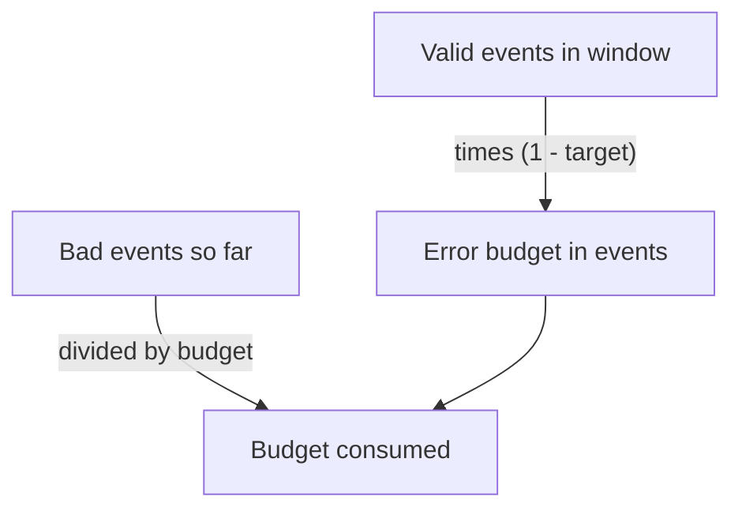

# Error Budgets

An objective of 99.9 percent sounds strict, but it also says that 0.1 percent of events may fail. Teams that treat every failure as a defect cannot ship changes, and teams that ignore failures lose users. An error budget turns the allowed failure into a quantity that the team can count, spend and protect. This part explains how to calculate a budget, how to measure how much of it is used, and how teams decide with it.

## What An Error Budget Is

An error budget is the amount of failure that an SLO allows in its window. It equals one minus the target, applied to the events of the window. For a 99 percent objective the budget is 1 percent of the valid events.

The budget is a shared resource. Incidents spend it, and so do risky deployments, planned maintenance and dependency failures. When budget remains, the team can accept the risk of a change. When the budget is gone, the objective is already missed for the window.

## Request-Based Budgets

For a request-based SLI the budget is a count of bad events. The count is the allowed bad share times the number of valid events in the window. Take a service that handles 10,000,000 requests in 30 days with a 99.9 percent objective. The allowed bad share is 0.001, so the budget is 10,000 failed requests.

The budget grows with traffic. If the same service handles 20,000,000 requests in the next window, the budget is 20,000 failed requests. A request-based budget therefore says how many failures are allowed, and it does not say how many minutes of outage that is. A short outage at high traffic can use more budget than a long one at night.



The diagram shows that the budget comes from the target and the traffic, and that the consumed share comes from the bad events divided by the budget.

## Time-Based Budgets

A time-based SLI counts minutes or intervals as good or bad, for example a minute is bad if its error ratio is above a limit. The budget is then a number of minutes. At 99.9 percent over 30 days the window has 43,200 minutes, so the budget is 43.2 bad minutes.

Time-based budgets are easy to explain to people outside the team. They also hide the size of each failure, because a minute with one failed request and a minute with all requests failed count the same. Choose the kind that matches the SLI definition, and do not convert one into the other without saying so.

## A Worked Example Of Spending

A service has a 99.9 percent objective over 30 days and handles about 330,000 requests per day, which is 10,000,000 requests in the window. The budget is 10,000 failed requests. On day 3 a faulty deployment fails 2,000 requests before the team rolls it back. That spends 20 percent of the budget.

On day 12 a dependency fails and 4,500 requests return errors. The consumed share is now 65 percent. The remaining budget is 3,500 requests, which is 35 percent. The team now decides that a large database migration planned for day 15 waits until the budget recovers, because one more failure of that size would break the objective.

With a rolling window the old failures leave the window after 30 days. The failures of day 3 stop counting on day 33, and the budget grows back by 2,000 requests at that time. With a calendar window the whole budget returns on the first day of the next month.

## Measuring Budget Consumption

The consumed share of a budget is the bad events divided by the budget. A value of 0 means nothing is spent, 1 means the budget is gone, and a value above 1 means the objective is missed for the window. The remaining share is one minus the consumed share.

The playground has only a few minutes of data, so the commands below use a five-minute window instead of 30 days. The first command connects to the playground and defines a helper that sends a PromQL query to Prometheus through the `shuttle` pod.

<!-- astrona:playground:renew -->

```sh
export KUBECONFIG="$(astrona kubeconfig ats-047-playground-060-02)"
test "$(kubectl config current-context)" = "kind-astro-ats-047-playground-060-02" || exit 1
query_prometheus() {
  kubectl -n starfleet exec shuttle -- python -c "import sys,urllib.parse,urllib.request; print(urllib.request.urlopen('http://prometheus:9090/api/v1/query?'+urllib.parse.urlencode({'query':sys.argv[1]}),timeout=8).read().decode())" "$1"
}
```

The next query divides the bad events of the window by the budget of a 99 percent objective, which is the valid events times 0.01.

```sh
query_prometheus 'sum(increase(lab_requests_total{status="500"}[5m])) / (sum(increase(lab_requests_total[5m])) * (1 - 0.99))'
```

The result is a single number in the `data.result[0].value` field of the JSON response. The traffic generator fails one request in ten, which is ten times the allowed share of 0.01, so the number is about 10. A value above 1 means that this window spent more than its whole budget. The same query over a longer range would grow more slowly, because the failures are divided by more requests.

## Who Spends The Budget

Not every failure comes from the team's own work. Some budget goes to causes the team cannot prevent, such as a cloud provider outage. Some goes to changes the team chose to make. Tracking the causes shows which part of the spending the team controls.

A simple record per incident helps: the date, the bad events, the cause and the fix. After a few months the record shows whether deployments, dependencies or capacity use most of the budget. That tells the team where reliability work pays off the most.

## Deciding With A Budget

The budget gives a rule for decisions that does not depend on opinions. A team writes an error budget policy before a problem happens. A typical policy says that releases continue as normal while budget remains, that risky changes wait when the budget is almost used, and that the team works on reliability when it is gone.

The policy needs agreement from product owners and engineers, because it limits feature work. It also works in the other direction. A service that keeps most of its budget unused for months has a target that is too strict, or it is spending too little on change. The team can then ship faster or relax a safeguard.

## Evidence Limits

A budget is only as good as the events behind it. Low traffic makes a ratio unstable, because one failed request is a large share of a few requests. Missing data removes both good and bad events, so a silent gap looks like no failures. A budget for a whole service can also hide a region or route that failed completely while the total stayed within the target.

State the exclusions and the aggregation in the SLO definition, and check that the data exists for the whole window. Without those checks the remaining budget is a number with no meaning.

## What You Know Now

An error budget is the allowed failure of an SLO window. A request-based budget counts events, a time-based budget counts bad minutes, and the consumed share is the bad events divided by the budget. A team can use the remaining budget to decide about releases and reliability work. The open question is how fast the budget is being used right now, and that is what the burn rate measures.

## Common pitfalls

> [!WARNING]
> A request-based budget does not convert into minutes of outage. A short window in a query shows the consumed share of that window only, not of the 30 day window. A gap in the data hides failures instead of showing zero.
