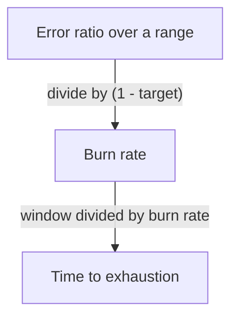

# Burn Rate

The consumed share of a budget tells a team where it stands, but it says nothing about how fast it got there or how soon the budget will be gone. A team that sees 40 percent consumed cannot tell if that took a month or an hour. The burn rate answers that question. This part defines the burn rate, shows how to turn it into a time until the budget is exhausted, and explains why the choice of the measuring window matters.

## What Burn Rate Is

The burn rate is the speed at which a service uses its error budget, compared with the speed that would use exactly the whole budget over the whole SLO window. It is the observed error ratio divided by the allowed error ratio, which is one minus the target.

A burn rate of 1 means the service fails at exactly the allowed rate, so the budget lasts the full window. A burn rate of 2 uses the budget twice as fast, so it is gone after half the window. A burn rate of 0 means no failures. The burn rate has no unit, because it is a ratio of two ratios.

## From Burn Rate To Time Left

At a constant burn rate, the time until the budget is gone is the window length divided by the burn rate. This holds when the whole budget is still unspent. For a 30 day window the time to exhaustion is 30 days divided by the burn rate.

| Burn rate | Time to use the whole budget | Budget used in one hour |
| --------- | ----------------------------- | ----------------------- |
| 1 | 30 days | 0.14 percent |
| 6 | 5 days | 0.83 percent |
| 14.4 | about 2 days | 2 percent |
| 720 | 1 hour | 100 percent |

The last column is the burn rate times one hour divided by the 720 hours of the window. A burn rate of 14.4 uses 2 percent of a 30 day budget in one hour, which is a number often used as a threshold for urgent alerts.



The diagram shows that the burn rate comes from a measured error ratio and the target, and that the time left follows from the burn rate.

## An Example With The Probe

The `probe` Service fails one request in ten. The error ratio is 0.1. A 99 percent objective allows 0.01, so the burn rate is 0.1 divided by 0.01, which is 10. If the failures continue, a 30 day budget is gone in 3 days.

The commands below compute that number from the live counters. The first command connects to the playground and defines a helper that sends a PromQL query to the Prometheus API through the `shuttle` pod.

<!-- astrona:playground:renew -->

```sh
export KUBECONFIG="$(astrona kubeconfig ats-047-playground-060-02)"
test "$(kubectl config current-context)" = "kind-astro-ats-047-playground-060-02" || exit 1
query_prometheus() {
  kubectl -n starfleet exec shuttle -- python -c "import sys,urllib.parse,urllib.request; print(urllib.request.urlopen('http://prometheus:9090/api/v1/query?'+urllib.parse.urlencode({'query':sys.argv[1]}),timeout=8).read().decode())" "$1"
}
```

Now divide the error ratio over a 20 second range by the allowed error ratio. The parentheses keep the division in the right order.

```sh
query_prometheus '(sum(rate(lab_requests_total{status="500"}[20s])) / sum(rate(lab_requests_total[20s]))) / (1 - 0.99)'
```

The value in `data.result[0].value` is close to 10. If the result list is empty, Prometheus has too few samples in the range, so wait a few seconds and run the command again. Prometheus calculated the value from the counters of the `probe`, and the `probe` itself only counts requests.

## The Window Decides What You See

The range in the query is the burn rate window. A short window reacts quickly, but it is noisy, because a few failed requests in a short time can give a high value. A long window is stable, but it reacts slowly, because a recent outage is diluted by the older good traffic.

Run the same query with a longer range and compare it with the short one.

```sh
query_prometheus '(sum(rate(lab_requests_total{status="500"}[1m])) / sum(rate(lab_requests_total[1m]))) / (1 - 0.99)'
```

With steady traffic both values are close to 10. During a real outage that starts suddenly, the short window rises first and the long window follows later. Neither window is correct on its own, which is the reason that alerting practice combines two windows.

## Burn Rate And Traffic

The burn rate is a ratio, so it does not depend on the traffic volume. A burn rate of 10 at night with few requests and a burn rate of 10 at noon with many requests both use the budget ten times faster than allowed. The budget in events is still different, because the amount of traffic in the whole window decides how many failures that is.

Low traffic gives a noisy burn rate. When a service handles only a handful of requests in the range, one failure gives a ratio of 20 or 50 percent and a huge burn rate. Teams handle this with a longer window for low-traffic services, or with a synthetic check that adds steady traffic.

## Burn Rate Below One

A burn rate under 1 is normal and useful. It means the service fails less than the objective allows, and the budget is not used up by the end of the window. A burn rate of 0.5 over a long period leaves half of the budget for incidents and changes.

A team that sees a burn rate far below 1 for months can ask if the target is too strict. A burn rate near 1 all the time leaves no room for an incident, because any extra failure breaks the objective.

## What You Know Now

The burn rate is the observed error ratio divided by the allowed error ratio. It converts into a time until the budget is gone by dividing the window by the burn rate. The range of the query decides how fast the value reacts and how much noise it holds. The open question is which values should call a human, and in which windows, and that is a question of alerting.

## Common pitfalls

> [!WARNING]
> The time to exhaustion is valid only when the whole budget is unspent and the burn rate stays constant. A burn rate computed over a very short range on low traffic gives large values from a few failures. A missing parenthesis in the query divides in the wrong order and returns a wrong number without an error.
