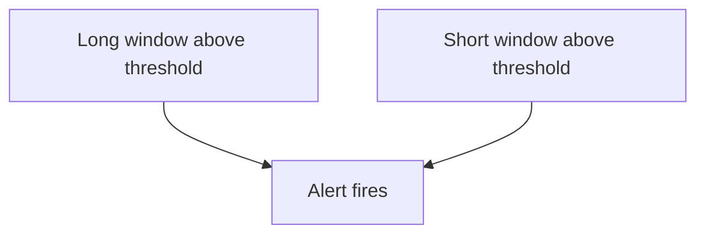

# Burn Rate Alerts

A burn rate that nobody sees does not protect users. The team needs a notification when the budget is used too fast, and no notification when nothing needs a human. Alerts on raw error counts fail at both: they fire on harmless spikes and stay silent on slow, steady loss. This part explains alerting on the burn rate, why a good alert checks two windows, and how to write the rules in Prometheus.

## Why Not Alert On The Error Ratio

An alert such as "the error ratio is above 1 percent" ignores the objective. For a 99 percent objective it fires at the allowed limit, which is not an emergency. For a 99.99 percent objective it fires long after the budget is gone. The same threshold means different things for different services.

The burn rate carries the objective inside it, so one threshold means the same thing everywhere: "the budget is used N times faster than allowed". The team chooses N from how fast it must react. A high N catches fast, large failures. A low N catches slow, steady losses before they use the budget.

## Two Windows In One Alert

A single window has a trade-off. A long window, such as one hour, is stable but keeps firing long after the problem is fixed, because the failures stay in the range. A short window, such as five minutes, resets quickly but fires on short bursts.

An alert that needs both windows above the threshold gets the benefits of each. The long window shows that the loss is large enough to matter. The short window shows that the loss is still happening. The alert resolves soon after the fix, because the short window drops first.



The diagram shows that the alert fires only when both conditions are true. A common choice makes the short window one twelfth of the long window.

## Several Severities

One pair of windows does not fit every case. A fast burn needs a response in minutes, and a slow burn can wait for working hours. The table lists a widely used set for a 30 day window.

| Severity | Burn rate | Long window | Short window | Budget used |
| -------- | --------- | ----------- | ------------ | ----------- |
| Page | 14.4 | 1 hour | 5 minutes | 2 percent |
| Page | 6 | 6 hours | 30 minutes | 5 percent |
| Ticket | 1 | 3 days | 6 hours | 10 percent |

Each row is a burn rate times a window divided by the 720 hours of the SLO window. For example, 6 times 6 hours divided by 720 hours gives 5 percent. A page wakes someone, and a ticket goes to a queue.

## Writing The Rules In Prometheus

Prometheus evaluates rules from rule files, which are YAML documents with groups of rules. A recording rule stores the result of an expression as a new series, so later rules and dashboards read a cheap series instead of repeating a long query. An alerting rule has an `expr` and a `for` duration. The alert is pending while the expression is true and fires after it has stayed true for the `for` time.

The playground evaluates rules every two seconds, so the windows are scaled down to 20 seconds and one minute. The rules below record the burn rate for both windows and alert when both are above 5. The playground Prometheus reads the rule file from the ConfigMap `prometheus-rules`.

<!-- astrona:playground:renew -->

```sh
export KUBECONFIG="$(astrona kubeconfig ats-047-playground-060-02)"
test "$(kubectl config current-context)" = "kind-astro-ats-047-playground-060-02" || exit 1
query_prometheus() {
  kubectl -n starfleet exec shuttle -- python -c "import sys,urllib.parse,urllib.request; print(urllib.request.urlopen('http://prometheus:9090/api/v1/query?'+urllib.parse.urlencode({'query':sys.argv[1]}),timeout=8).read().decode())" "$1"
}
```

Save this as `configmap-prometheus-rules.yaml`:

```yaml
apiVersion: v1
kind: ConfigMap
metadata:
  name: prometheus-rules
  namespace: starfleet
data:
  rules.yaml: |
    groups:
    - name: probe-burn-windows
      rules:
      - record: probe:burn_rate:rate20s
        expr: (sum(rate(lab_requests_total{status="500"}[20s])) / sum(rate(lab_requests_total[20s]))) / (1 - 0.99)
      - record: probe:burn_rate:rate1m
        expr: (sum(rate(lab_requests_total{status="500"}[1m])) / sum(rate(lab_requests_total[1m]))) / (1 - 0.99)
      - alert: ProbeBudgetBurnBothWindows
        expr: probe:burn_rate:rate1m > 5 and probe:burn_rate:rate20s > 5
        for: 10s
        labels:
          severity: page
        annotations:
          summary: The budget burns more than five times faster than allowed in both windows.
```

Apply it:

```sh
kubectl apply -f configmap-prometheus-rules.yaml
```

Prometheus reads rule files at start and on reload, and a mounted ConfigMap also updates with a delay. Restart the Deployment so that Prometheus starts with the new file:

```sh
kubectl -n starfleet rollout restart deployment/prometheus
kubectl -n starfleet rollout status deployment/prometheus --timeout=180s
```

Then check the result. Wait about a minute after the restart, because the one minute window needs samples and the alert needs its `for` time. The `ALERTS` series is a series that Prometheus creates for each pending or firing alert.

```sh
query_prometheus 'ALERTS{alertname="ProbeBudgetBurnBothWindows"}'
```

The response contains a series with the label `alertstate` set to `firing` once both windows are above 5 for 10 seconds. The burn rate of the `probe` is about 10, so the alert fires. If the series shows `pending`, the `for` time has not passed, so run the query again.

## Alert Content And Noise

An alert is a message to a person, so it needs a label for routing and an annotation that explains it. The label `severity` lets the alert routing component, Alertmanager, send pages to the on-call person and tickets to a queue. The `summary` annotation tells the reader which objective is at risk.

Every alert that fires without needing action teaches people to ignore alerts. Review fired alerts regularly, and remove or retune the ones that needed no action. Test a threshold against past incidents before it goes live.

## What You Know Now

An alert on the burn rate has the same meaning for every objective, because the objective is part of the value. Checking a long and a short window together keeps the alert stable and still lets it clear quickly. Recording rules store the burn rates, and an alerting rule with `for`, a `severity` label and a `summary` annotation turns them into a notification. The remaining work is practice: choosing windows and thresholds for a real service and recording the rules yourself.

## Common pitfalls

> [!WARNING]
> A recording rule name that differs from the name used in the alert returns no data and the alert never fires. A rule file with a YAML error stops the new rules from loading, so check the Prometheus pod after the restart. Windows copied from another service with a different objective or period give wrong thresholds.
